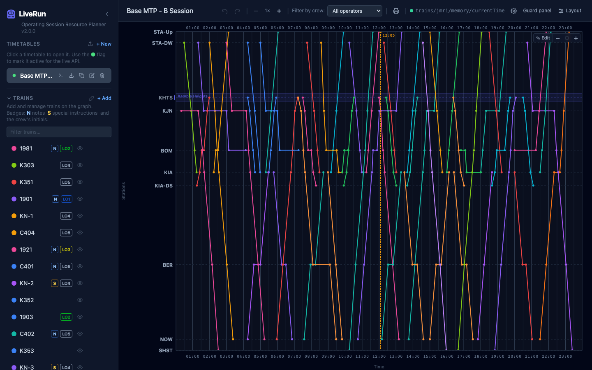
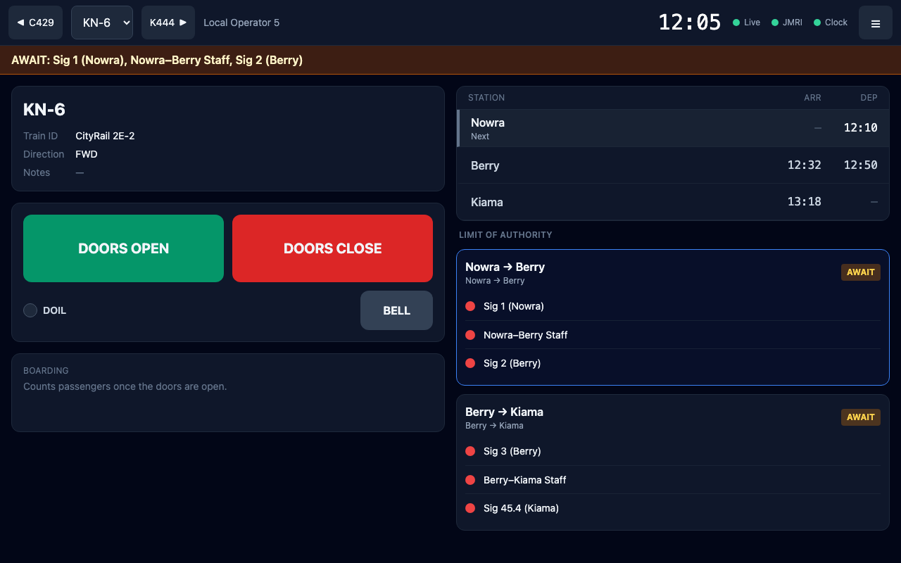
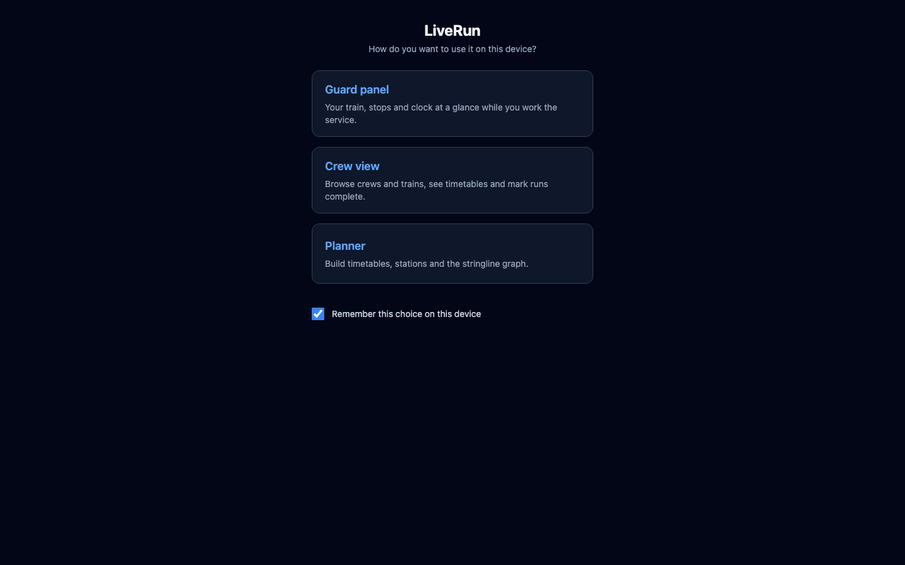

# LiveRun user guide

LiveRun plans and runs model railway operating sessions. You build the session's timetable on a train graph and give the trains to crews. During the session, crews follow their jobs on their phones and guards work their trains from tablets, with doors, passengers, scripted events and limit of authority. Control can change anything as the session runs and everyone sees it within a second or two.

- [The three screens](#the-three-screens)
- [Who should read what](#who-should-read-what)
- [A first session in 10 steps](#a-first-session-in-10-steps)
- [Glossary](#glossary)

## The three screens

| Screen | For | Where |
|--------|-----|-------|
| **[Planner](planner.md)** | Building timetables and running the session as Control, on a desktop or laptop | The app's address (add `?desktop` to force it) |
| **[Crew view](crew-view.md)** | Crews following their jobs on a phone | `…/mobile` |
| **[Guard panel](guard-panel.md)** | Guards working a train from a tablet | `…/guard` |

| Crew view | Guard panel |
|-----------|-------------|
|  |  |

### Choosing a screen on a device

Opening LiveRun on a phone or tablet shows the **mode picker**: **Guard panel**, **Crew view** or **Planner**. With **Remember this choice on this device** ticked (the default), the device opens straight into that screen from then on.

- To choose again: **Switch** (crew view) or **☰ → Switch mode** (guard panel), or open the address with `?choose`.
- A desktop browser opens the planner unless a choice has been remembered.
- `…/guard`, `…/mobile` and `?desktop` always go straight to that screen.

## Who should read what

| You are | Read |
|---------|------|
| **Layout owner / Control**: you build timetables, set up the layout and run sessions | [Planner](planner.md), [Running a session](running-a-session.md), [Layout settings](layout-settings.md), [Limit of authority](limit-of-authority.md) |
| **Guard**: you ride with a train on a tablet | [Guard panel](guard-panel.md) |
| **Crew / driver**: you follow your jobs on a phone | [Crew view](crew-view.md) |
| **Integrator**: you connect JMRI, CATS, displays or scripts | [Integrations](integrations.md) |

Something not working? See [Troubleshooting](troubleshooting.md).

On some layouts the driver is also the guard. Limit of authority is only on the guard panel, so that person should use it.

## A first session in 10 steps

1. **Create a timetable**: **+ New** under *Timetables*, with a name and the graph's start and end time. ([Planner → Timetables](planner.md#timetables))
2. **Add stations** with a graph position each; use branch names to group lines. ([Stations](planner.md#stations))
3. **Add paths** (optional): stopping patterns with running times, so trains fill themselves in. ([Paths](planner.md#paths-route-templates))
4. **Add trains**: name, colour, train ID (the JMRI roster name), stop times. ([Trains](planner.md#trains))
5. **Add crews** and give them trains, by hand or with **Auto-assign**. Tick **Guard** for crews that will use the guard panel. ([Crews](planner.md#crews))
6. **Connect the fast clock**: ⚙ → **Fast clock**, your MQTT broker's WebSocket address and the clock topic. ([Settings](planner.md#settings-and-the-fast-clock))
7. **Set up the layout** (for the guard panel): JMRI URL, train profiles for your locos, and optionally boarding, guard events and limit of authority. ([Layout settings](layout-settings.md))
8. **Make the timetable active**: click its dot so it shows 🟢.
9. **Hand out devices**: phones open the **Crew view**, tablets the **Guard panel** (**Tap to start**, pick the crew, open the first train).
10. **Run the session.** Export a JSON backup first, then follow [Running a session](running-a-session.md).

## Glossary

**Active timetable**: the timetable marked 🟢 in the planner. The crew view, guard panel, live API and limit of authority all follow it.

**Control**: whoever runs the session from the planner.

**Crew / job**: a crew is a named operator (or team) in a timetable. A job is a train assigned to a crew.

**Dwell / pass**: the time a train stands at a stop. A stop with the same arrival and departure is a *pass*: the train runs through.

**Fast clock**: the session's model time, published over MQTT (usually by JMRI). It drives the graph's clock line, the crew view, the guard panel's current stop and en-route events.

**Graph position**: a station's place on the graph's vertical axis. The km label is a separate, display-only number.

**Guard event**: a hidden, scripted happening (a late passenger, a door fault, …) placed on a train's stops. Only the guard panel sees it, when it fires.

**Limit of authority (LOA)**: whether a train may enter a section of line, worked out from live signal, token and condition states. **Section**: a one-way stretch from one station to another. **Element**: one watched signal, token, condition or selector. **Grant**: every granting element clear at once. **Revoke / release**: a revoking element (e.g. a staff) going back to not clear.

**Location alias**: a different name for one train's stop at a station, e.g. a staging road shown as "Sydney Terminal".

**MQTT broker**: the messaging server that carries the fast clock, LOA values, boarding stats and guard event messages. Set per timetable.

**Run order / running order**: the order a train actually visits its stops. The planner lists stops in station order, so an Up train appears bottom to top there.

**Run status**: a train marked **running** or **completed** during the session. It's separate from the timetable and not part of undo.

**Special instruction**: a public note on one stop, printed on station reports and shown on station boards. The guard panel doesn't show it.

**Train ID**: the loco's JMRI roster name. It's how the guard panel finds the loco and how train profiles match.

**Train profile**: Layout settings that give every train whose train ID matches a pattern its tablet sounds and decoder functions.

---

Last checked against v2.0.0.
