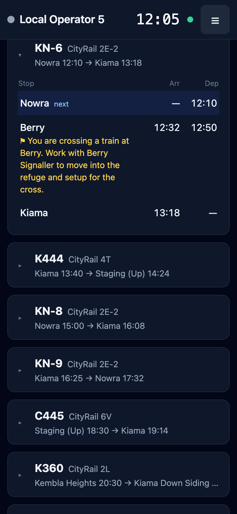
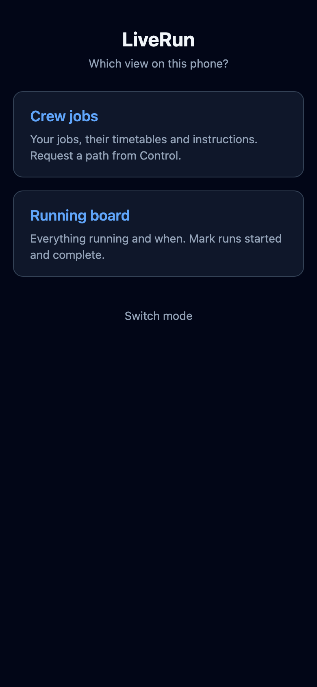
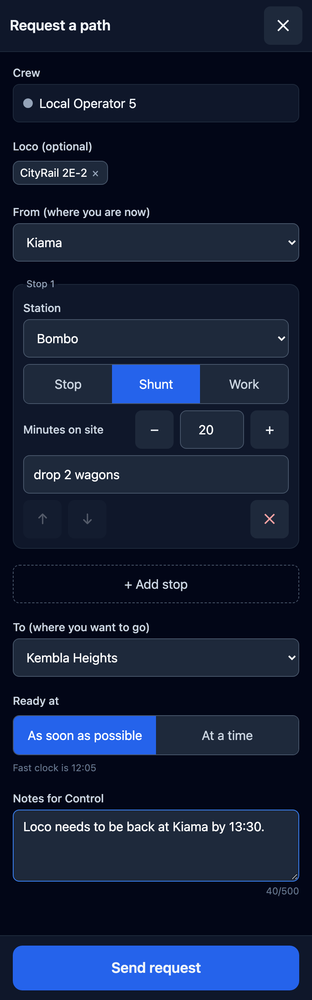
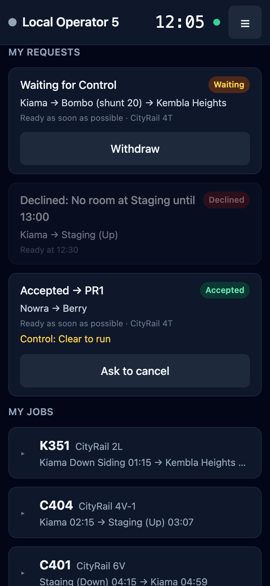

# Crew jobs

**What this page is for:** following your own jobs on a phone, and asking Control for a path when you need one.
**Who it's for:** train crews and drivers.

- [Opening it](#opening-it)
- [My jobs](#my-jobs)
- [Requesting a path](#requesting-a-path)
- [My requests](#my-requests)

## Opening it

Open LiveRun on your phone and choose **Mobile** in the [mode picker](README.md#choosing-a-screen-on-a-device). On a phone that hasn't been used before, LiveRun then asks which view you want:

- **Crew jobs**: your jobs, their timetables and instructions, and a way to request a path from Control. This page.
- **Running board**: everything running and when, with run buttons. See [The Running board](crew-view.md).

The phone remembers your choice. If Control hands out a QR code or link, it can pick the view for you: `…/mobile?view=jobs` opens Crew jobs and `…/mobile?view=board` the Running board, and the phone remembers that choice too.

The first time, Crew jobs asks **Who are you?** Pick your crew. Every crew in the timetable is listed; the choice is remembered on this phone, for this timetable.

The **☰** menu in the top right has:

| Item | Does |
|------|------|
| **Change crew** | Back to **Who are you?** |
| **Change view** | Back to the mobile view picker (Crew jobs or Running board) |
| **Switch mode** | Back to the mode picker (guard panel, mobile, planner) |
| **Help** | Opens this page |

Crew jobs shows the **active timetable**, the one Control has marked active in the planner. If Control switches to another one, your screen follows and tells you (**Control switched to …**). If none is active, it says **No session is running**.

The header shows your crew's colour and name, the fast clock (grey while it's disconnected), and a dot: green means you're live and Control's changes appear by themselves, amber means connecting, red means reconnecting. The screen catches up on anything it missed as soon as it's back, including after the phone wakes from sleep.

## My jobs

**My jobs** lists the trains assigned to your crew, in the order they run. Each card shows the train's name, its loco (train ID), and where it runs from and to with the start and end times.

- Tap a card to open or close it. The job you're on, or the next one, opens by itself.
- An open card lists each stop in running order with its **Arr** and **Dep** times. If Control gave a stop a different name for this train (a siding or staging road), it's shown after the station name.
- A line starting with an amber flag (⚑) is a **special instruction** for that stop. Read these before you start.
- With the fast clock running, the stop you should be at is highlighted and marked **now** (standing at it) or **next**.
- **Notes** from Control are shown under the stops. A blue **Requested** badge means the job was created from a path request.
- A green **Running** or grey **Done** badge shows the train's run status. You can't change it here; use the [Running board](crew-view.md#marking-runs) to mark runs started and finished.

Crew jobs follows Control's changes live, with no refresh and no sounds. A new job gets a **New job** toast and a green ring for a minute, and retimed stops are highlighted for 10 seconds. The same notices as on the Running board appear when a job is retimed, renamed or taken off your crew, and **Control changed n of your jobs** when there are more than five changes at once. See [When Control changes something](crew-view.md#when-control-changes-something).

## Requesting a path

When you need to go somewhere your jobs don't take you, tap **+ Request a path**. Control sees it straight away and plots a train for you on the graph. You see it arrive as a new job.

| Field | What to enter |
|-------|---------------|
| **Crew** | Fixed: your crew |
| **Loco (optional)** | The loco's roster name or number. It starts as the loco of your current job |
| **From (where you are now)** | The station you're at. It starts as where your current or latest job ends. At stations that allow it, a **Siding / road** box lets you name the road |
| **+ Add stop** | A stop between From and To, if you need one (fields below). You can add up to 18; ↑ ↓ reorder them and ✕ removes one |
| **To (where you want to go)** | The destination |
| **Ready at** | **As soon as possible**, or **At a time** and a time. Control starts your train at that time, or a couple of minutes after the fast clock if that time has already passed |
| **Notes for Control** | Anything else, up to 500 characters |

Each added stop has:

- **Stop / Shunt / Work**: **Stop** is a station you stop at or pass through. **Shunt** and **Work** say you'll be busy there, for example shunting a yard or working a siding.
- **Minutes on site**: how long you'll be there, from 0 to 240 (the − and + buttons move in fives).
- **Note for this stop**: for example, *drop 2 wagons*.

A **Shunt** or **Work** stop becomes a special instruction on the job, such as *Shunt 20 min: drop 2 wagons*, so you'll see it under My jobs.

**Send request** stays off until the form is complete, and the message above it says what's missing: pick both ends; From and To must be different; every added stop needs a station; each station can appear only once; and a time must be chosen under **At a time**.

If Control's server refuses the request, the reason appears in red above the button and the form stays open. See [Troubleshooting](troubleshooting.md#crew-jobs).

> **Note** The **+ Request a path** button is only there while your timetable is the active one and Control hasn't turned requests off. The whole timetable can hold 50 open requests at once.

## My requests

Sent requests appear as cards under **My requests**, above **My jobs**. Open ones come first, then the newest.

| Badge | Meaning | What you can do |
|-------|---------|-----------------|
| **Waiting** | Control hasn't picked it up yet | **Withdraw** |
| **Plotting** | Control is working out your path | **Withdraw** |
| **Accepted** | Your train is on the timetable. The card names it (**Accepted → PR1**), and says so if Control gave it to another crew | **Ask to cancel** |
| **Declined** | Control refused it, and gave a reason | Nothing; send a new request if you still need one |
| **Withdrawn** | You took it back | Nothing |
| **Cancelled** | Control agreed to your ask to cancel and removed the train | Nothing |

Each card shows the route (for example *Kiama → Bombo (shunt 20) → Kembla Heights*), when you're ready, the loco, and any **Control:** note.

**Withdraw** asks you to confirm (**Yes, withdraw** or **Keep**). If Control picked the request up at the same moment, you may be told the request has moved on; the card then shows what happened.

**Ask to cancel** is for an accepted request you no longer need. You can type a reason, then **Send request**. The train stays on the timetable until Control agrees: the card shows **Cancel asked: Waiting for Control**, and then either **Cancelled** or **Cancel refused** with Control's note. You can ask again after a refusal.

You also get a toast when something changes: **Control is plotting your path**, **Path accepted → PR1**, **Declined: …**, **Cancelled: …** or **Cancel refused: …**. An accepted card fades after five minutes; declined, withdrawn and cancelled ones stay dimmed until Control clears closed requests.

For what Control does with your request, and what is recorded about it, see [Path requests](path-requests.md).

---

Last checked against v2.1.0.
