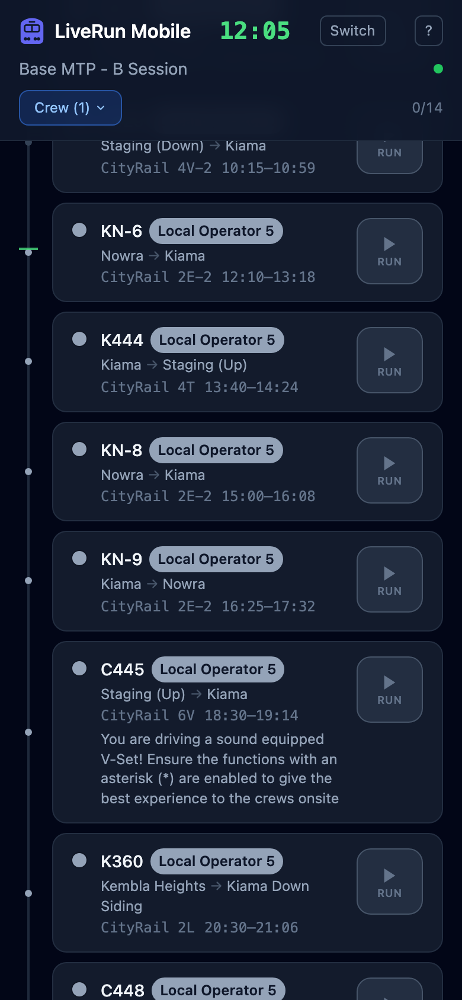
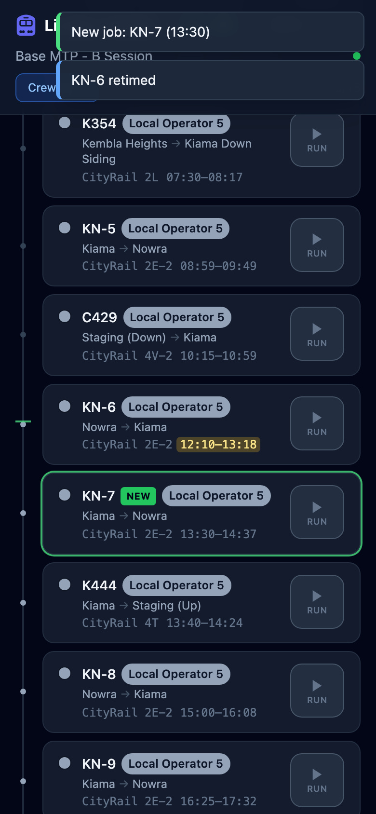

# The crew view

**What this page is for:** following your jobs on a phone during a session.
**Who it's for:** crews and drivers.

- [Opening it](#opening-it)
- [Your jobs](#your-jobs)
- [Marking runs](#marking-runs)
- [When Control changes something](#when-control-changes-something)

## Opening it

Open LiveRun on your phone and choose **Crew view** in the [mode picker](README.md#the-three-screens), or go straight to `…/mobile`. Tick **Remember this choice on this device** and your phone opens the crew view every time. **Switch** in the top right takes you back to the mode picker, and **?** opens this page. Tapping **LiveRun Mobile** opens the planner.

The crew view shows the **active timetable** (the one Control has marked active in the planner). If Control switches to another timetable, your screen follows it and tells you. To pin one timetable regardless of what's active, open `…/mobile?id=<timetable id>`.

## Your jobs

- **The clock** at the top is the fast clock when it's running, otherwise the time of day.
- **The green dot** next to the timetable name means you're live: changes from Control appear by themselves.
- **Crew (n)** filters the list to one or more crews. Tick yours, and the choice is remembered on this phone. **Clear filter** shows everyone again.
- **0/14** counts how many of the listed jobs are done.

Each card is one train in time order: its name, crew, where it runs from and to, the loco (train ID), its start and end times, and the train's notes. The line down the left edge has a marker at the current time, so you can see where you are in the day.

## Marking runs

The button on each card cycles a train's status:

| Button | Does |
|--------|------|
| **Run** | Marks it **running** |
| **Done** | Marks it **completed** |
| **Reset** | Clears it |

Statuses are shared: everyone's crew view, the planner's crew list and the train graph show them straight away. Once any train has a status, a reset button appears in the header (**Reset all statuses**). It clears every status in the timetable, for example after a test run.

> **Note** Run status is separate from the timetable itself. Undo in the planner never brings it back.

## When Control changes something

You don't need to refresh. Within a second or two:

| Control… | You see |
|----------|---------|
| gives you a train | a **New job: KN-7 (13:30)** toast, and the card has a green ring and a **NEW** badge for a minute |
| retimes one of your trains | a **KN-6 retimed** toast, and its times are highlighted for 10 seconds |
| takes a train off you | **KN-6 → Local Operator 6** (or **KN-6 removed**) |
| renames a train | **K351 renamed to K353** |
| makes more than five changes at once | one toast: **Control changed n of your jobs** |
| removes your crew | **Crew … removed by Control**, and the filter drops it |
| switches the active timetable | **Control switched to …** |
| deletes the timetable you're looking at | a notice that it was deleted by Control |

If the dot isn't green, you're reconnecting. The screen catches up on everything it missed as soon as it's back, including after the phone wakes from sleep.

---

Last checked against v2.0.0.
