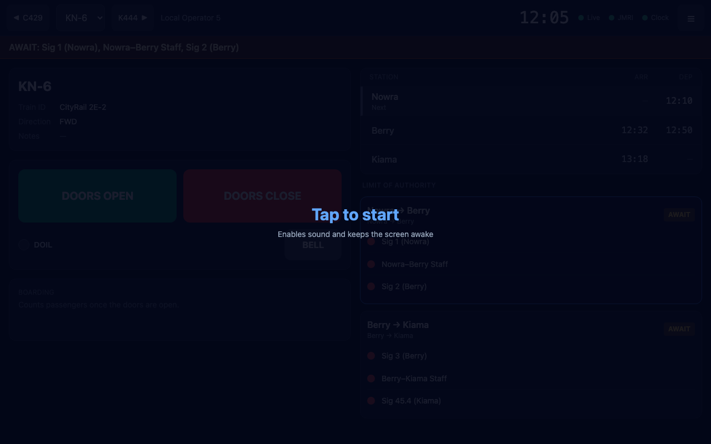
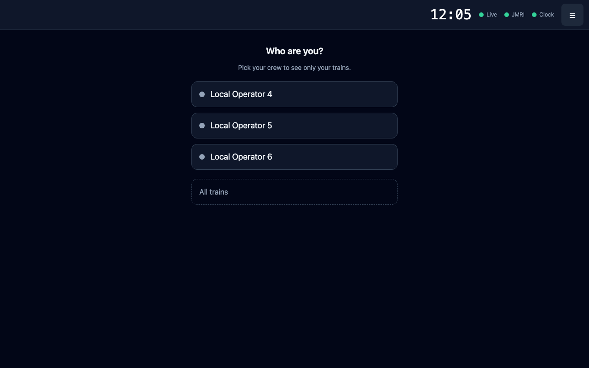
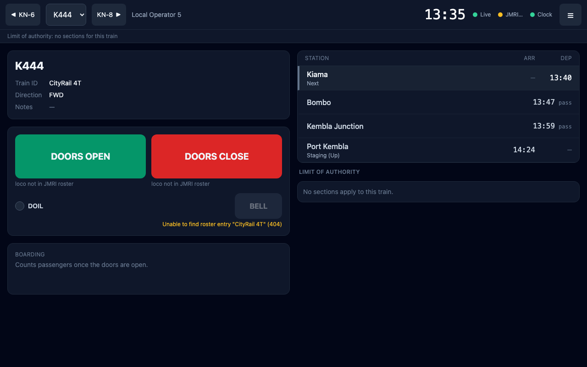
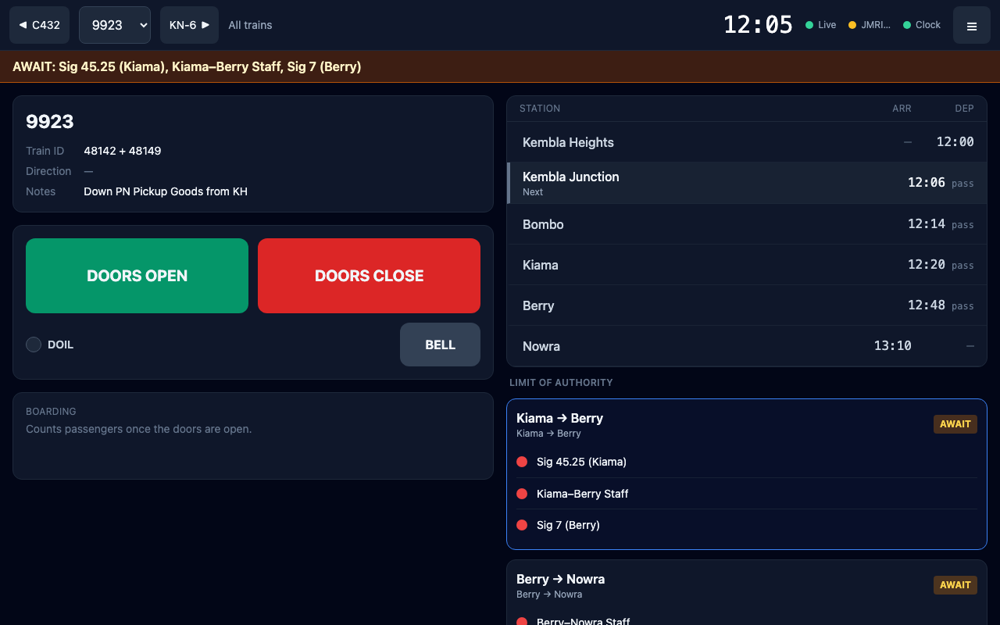
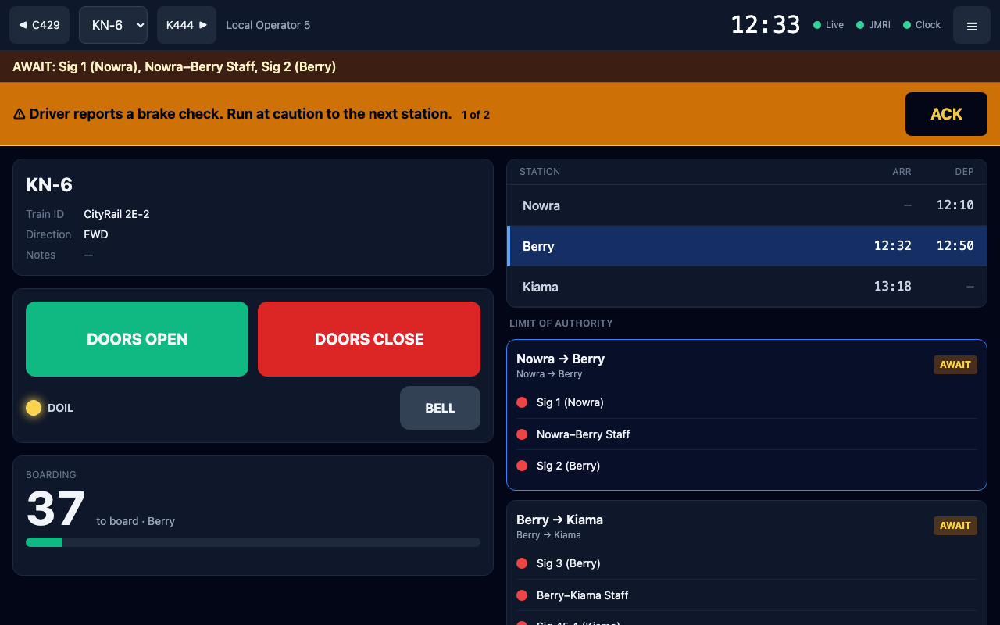
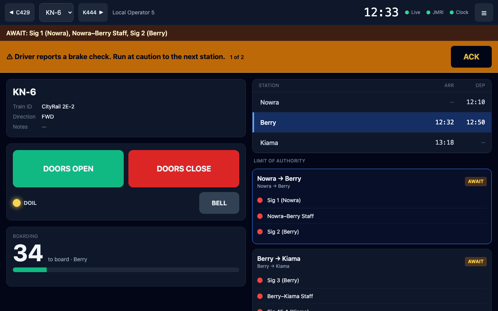
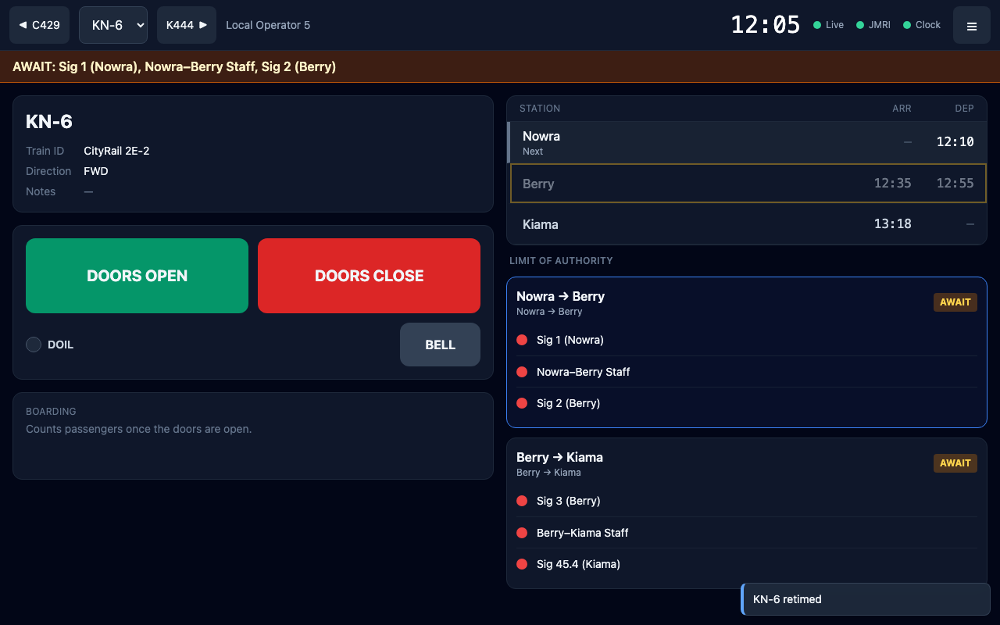
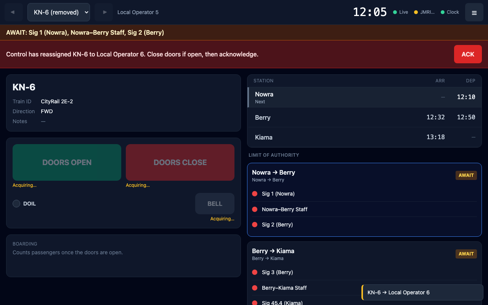
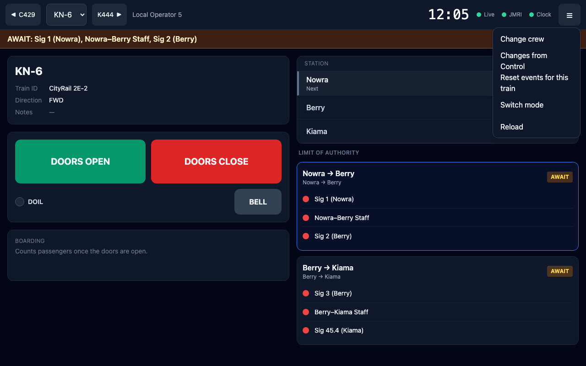

# The guard panel

**What this page is for:** working a train from a tablet, covering the doors, bell, passengers, scripted events, limit of authority and Control's changes.
**Who it's for:** guards (and drivers who are also their own guard).

- [Getting started](#getting-started)
- [The screen at a glance](#the-screen-at-a-glance)
- [The stop list](#the-stop-list)
- [Doors, DOIL and bell](#doors-doil-and-bell)
- [Boarding](#boarding)
- [Guard events](#guard-events)
- [Limit of authority](#limit-of-authority)
- [Changes from Control](#changes-from-control)
- [The menu](#the-menu)
- [When a connection drops](#when-a-connection-drops)

---

## Getting started

1. Open LiveRun on the tablet and choose **Guard panel** in the [mode picker](README.md#choosing-a-screen-on-a-device), or go straight to `…/guard`. With **Remember this choice on this device** ticked, the tablet opens the guard panel every time.
2. Tap **Tap to start**. This lets the tablet play sounds and keeps the screen awake. Browsers need one tap before they will make a sound.

   

3. **Who are you?** Pick your crew. Your trains are listed in the order you work them. **All trains** lists every train in the timetable.

   

   Only crews that Control has ticked **Guard** for in the planner are listed. If the list is empty, ask Control to tick yours.

4. The panel opens on the train you're due to work next, going by the fast clock. If you pick a train yourself, the tablet remembers it.

> **Important** Open your first train **before Control sets up its authority**. A tablet only sees an authority being *granted* if it's watching when the signals clear. See [Limit of authority](limit-of-authority.md#operating-rules).

The guard panel always follows the **active timetable** (the one marked active in the planner).

---

## The screen at a glance

**Header, left to right:**

| | |
|---|---|
| **◀ C429** | Your previous job (on a wide screen the button shows its name) |
| **KN-6 ▾** | The train you're working; pick another from the list |
| **K444 ▶** | Your next job |
| **Local Operator 5** | Your crew |
| **12:05** | The fast clock. It turns grey when the clock has stopped updating |
| **Live** dot | Green: connected to LiveRun. Amber: connecting. Red: reconnecting |
| **JMRI** dot | Green: connected and this train's loco is acquired. Amber (**JMRI…**): connecting, or acquiring the loco. Red (**JMRI off**): no connection. Hidden when no JMRI URL is set |
| **Clock** dot | Green: fast clock live. Red: **Clock off**. **No clock** if the timetable has none |
| **☰** | [The menu](#the-menu) |

Under the header is the **limit of authority strip** (on layouts that use LOA), then any banners.

**Left column:** the train card (name, **Train ID**, **Direction**, **Notes**), the doors card and the boarding card.
**Right column:** the stop list, then the **Limit of authority** sections.

---

## The stop list

Stops are shown in the order the train runs them. The current position follows the fast clock:

| Row | Means |
|-----|-------|
| Blue, left bar | The train is **at** this stop now (between arrival and departure) |
| Grey, **Next** | The next stop, while running between stops |
| Amber, **At platform** | You pinned this stop (below) |
| `12:14 pass` | The train runs through without stopping |

**Tap a stop to pin it** ("At platform"). Do this when the train is running early or late, or when there's no clock: boarding and station events then use the pinned stop. A pin lasts until **DOORS CLOSE**. Tap the row again to unpin it.

An **aliased** stop shows its alias first and the real station underneath, e.g. **Port Kembla** over *Staging (Up)*.

The guard panel never shows a stop's *special instructions*. Those are public notes for station reports and boards; scripted surprises for the guard use [guard events](#guard-events).

---

## Doors, DOIL and bell

The doors card drives the loco's decoder through JMRI and plays the tablet's sounds. Both come from the loco's [train profile](layout-settings.md#train-profiles): the first profile whose pattern matches the train ID.

- **DOORS OPEN** sends the profile's door-open function to the loco and plays the door-open sound. Boarding starts when that sound finishes (or after a set delay if the profile has no sound).
- **DOORS CLOSE** sends the door-close function and plays its sound. **DOIL** (the door indicator light) goes out when the close sound finishes.
- **DOIL** lights while the doors are open. When the profile opens and closes the doors with the same decoder function, DOIL follows the loco itself, so a driver toggling the doors on a handheld shows up here too.
- **BELL** rings the bell function and sound. Some profiles make it a hold-to-ring button.

The tablet acquires the loco for the train you're looking at and releases it when you change trains. Anything left switched on is switched off first.

### Why a button is disabled or marked

Under each button, an **amber** note means the button is **disabled** until JMRI is ready:

| Amber note | Means |
|------------|-------|
| **JMRI disconnected** | No connection to JMRI |
| **Acquiring…** | JMRI is handing over the loco |
| JMRI's own message, e.g. **Unable to find roster entry "CityRail 4T" (404)** | JMRI refused the loco. Check the train ID matches the roster name exactly |

A **grey** note means the button works, but only plays its sound because nothing will be sent to the loco:

| Grey note | Means |
|-----------|-------|
| **no roster ID** | The train has no train ID in the planner |
| **loco not in JMRI roster** | The train ID isn't in JMRI's roster, so a function set by label can't be looked up |
| **function label not on this loco** | The profile names a function label this loco doesn't have |
| **not mapped in profile** | The profile has no function for this button |

A loco whose profile maps no functions at all (sounds only, e.g. freight without a sound decoder) shows no notes: the buttons simply play sounds.

---

## Boarding

After **DOORS OPEN** the boarding card counts passengers on at the current stop:

- The big number is how many are **still to board**, with a bar for progress. **All aboard** shows when everyone's on.
- **Stragglers…** means the last few are taking their time.
- **RUNNER** (flashing) with **Someone is running for it…** means a late passenger is running for the train. Give them a moment.
- **DOORS CLOSE** before everyone is aboard leaves the rest behind: the card shows **Boarded 38 · 4 left behind**.
- At the last stop it shows **Terminates — all alight**.
- If your layout turns it on, an **alighting** count runs first, then boarding.

How many board depends on the time of day, the station, the train and where it is in its run. Control sets this up in [Layout settings → Boarding](layout-settings.md#boarding).

**Current stop unknown (no clock) — tap a stop in the list to set it:** the panel can't tell where you are. Pin the stop, then open the doors again.

A small red dot next to *Boarding* means boarding stats can't reach the MQTT broker right now. They're queued and sent when it's back.

---

## Guard events

Control can hide scripted events in a train's stops: a late passenger, a door fault, a brake check, stock on the line. You don't see them coming. When one fires:

- a flashing amber banner shows the message and the alert sound plays;
- the loco may do something (e.g. a brake squeal) if the event has a loco action;
- tap **ACK** once you've dealt with it. Several events queue up (**1 of 3**).

Station events fire a few seconds after a door moment at a stop. En-route events fire part-way between two stops, timed from when you actually left. An en-route event is dropped if you stop somewhere before it fires.

Each event is decided once per run of a train: whether it happens, its wording and its timing. That decision is kept on the tablet, so reloading the page or Control re-saving the train doesn't roll it again, and an un-ACKed banner is still there after a reload. The tablet forgets it 12 hours after it last changed, so the next session rolls afresh. To run the same train again within a session, use **☰ → Reset events for this train**: it throws the decision away and rolls again.

---

## Limit of authority

On layouts that use it, the strip under the header always shows your train's current section:

| Strip | Means |
|-------|-------|
| **Nowra → Berry · waiting for signal data: …** (grey) | LiveRun hasn't received values for these elements yet |
| **AWAIT: Sig 1 (Nowra), Nowra–Berry Staff, Sig 2 (Berry)** (amber) | Not all elements are clear yet. Don't go |
| **Nowra → Berry · AUTHORITY GRANTED** (green) | Every element cleared together. You have authority to the end of the section |
| **All sections complete** | Nothing more on this run |
| **Limit of authority: no sections for this train** | This train's route has no LOA sections |

The **Limit of authority** list under the stops shows every section on your route in order, with a dot per element (green clear, amber caution, red stop, grey **?** no data) and a badge: **AWAIT**, **GRANTED**, **COMPLETE** or **NO DATA**. The current section is outlined in blue.

Only the signalling drives it: the doors, the stop list and the clock have no effect, and there is no reset on the tablet. If it's wrong, Control fixes it at the signals. The full story is in [Limit of authority](limit-of-authority.md).

---

## Changes from Control

Control can change the timetable during the session; the panel shows changes within a second or two:

- **Toasts** (bottom right) for each change to your jobs: **New job: KN-7 (13:30)**, **KN-6 retimed**, **KN-6 → Local Operator 6**, **KN-6 removed**, **renamed to**. A new job also plays the alert sound.
- **Retimed stops flash** for 10 seconds in the stop list.
- **Your train is taken away** (removed, or given to another crew): a red banner says **Control has reassigned KN-6 to Local Operator 6. Close doors if open, then acknowledge.** The train stays on screen, and the doors still work, until you tap **ACK**. Then the panel moves to your next job.

  

- **Control switches timetable:** an amber banner (**Control has switched to …**) with **ACK**. Nothing changes under you until you acknowledge.
- **☰ → Changes from Control** lists every change this session with its time.

---

## The menu

| Item | Does |
|------|------|
| **Change crew** | Back to **Who are you?** |
| **Changes from Control** | This session's list of changes |
| **Reset events for this train** | Forget this train's rolled guard events and roll them again (asks first) |
| **Help** | Opens this page |
| **Switch mode** | Back to the mode picker (mobile, planner) |
| **Reload** | Reload the page |

---

## When a connection drops

| Lost | What still works | What doesn't |
|------|------------------|--------------|
| **JMRI** | Sounds; boarding; events; LOA | Buttons that send a function by F-number are disabled (**JMRI disconnected**); a reconnect picks the loco up again by itself |
| **The fast clock** (MQTT) | Everything, using the last time shown (grey) | The current stop no longer moves: pin it by tapping. En-route events can't fire |
| **LiveRun** (Live dot red) | The train on screen, doors, boarding, events | Control's changes and LOA updates. They arrive as soon as the connection is back, including after the tablet wakes from sleep |

See also [Troubleshooting](troubleshooting.md#guard-panel).

---

Last checked against v2.1.0.
