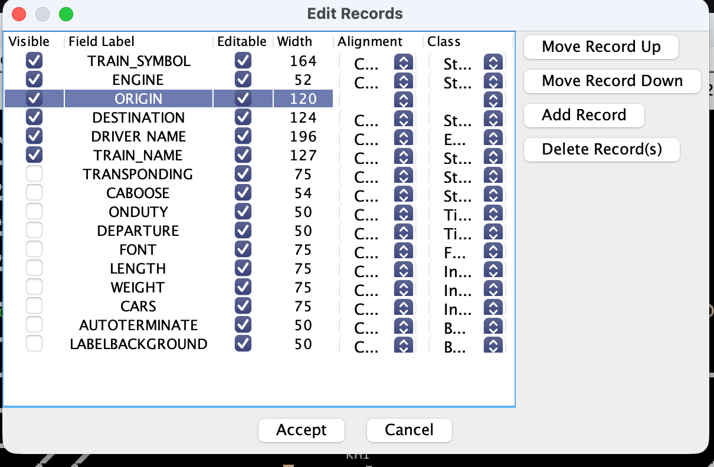

# Integrations

**What this page is for:** connecting LiveRun to other systems, covering the live REST API, WebSockets, MQTT, JMRI and CATS, plus deployment notes.
**Who it's for:** whoever looks after the layout's computers and displays.

- [Live REST API](#live-rest-api)
- [WebSockets](#websockets)
- [MQTT: what LiveRun reads and writes](#mqtt-what-liverun-reads-and-writes)
- [JMRI](#jmri)
- [CATS XML export](#cats-xml-export)
- [Deployment: sub-paths and security](#deployment-sub-paths-and-security)

The full, interactive API reference is at **`/api/docs`** on your LiveRun server (⚙ → **API Schema**). The OpenAPI document itself is at `/api/schema`.

---

## Live REST API

Read-only endpoints for station displays, guard panels of your own, and scripts. They serve the timetable you name by id; use the active timetable's id for "the session that's running".

| Endpoint | Returns |
|----------|---------|
| `GET /api/active-timetable` | `{ id }` of the timetable marked active in the planner |
| `GET /api/timetables/{id}/live/trains` | Every train, sorted by start time |
| `GET /api/timetables/{id}/live/trains/{trainName}` | One train with its full stopping list |
| `GET /api/timetables/{id}/live/stations/{stationName}` | Every train calling at a station, with each train's onward stops from there |
| `…/live/stations/{stationName}?direction=up` | The same, Up trains only (`down` for Down) |
| `…/live/stations/{stationName}?trainId=%cityrail%` | The same, filtered by train ID: `%` any run of characters, `_` one, case-insensitive |
| `GET /api/layout` | Layout-wide settings (JMRI, profiles, boarding, stats, events, LOA) |
| `GET /api/loa/values` | The last value of every LOA topic: `topic → { value, at }` |

**Direction** on the station board is worked out from station order: running towards higher graph positions is `down`, towards lower is `up`. The train's own *Direction* field is only used when that can't be decided.

**Example: a station display**

1. `GET /api/active-timetable` → `{ "id": "…" }`.
2. `GET /api/timetables/{id}/live/stations/Kiama` for a board with both directions,
3. or `…/stations/Kiama?direction=down` for one platform.

Stop **special instructions** and **location aliases** are included. Guard events never are: they're only in the full timetable (`GET /api/timetables/{id}`), which the planner uses.

Everything else under `/api` (creating and editing timetables, stations, trains, crews, paths, layout) is what the planner itself uses; see `/api/docs`. Mutations return the whole updated timetable.

---

## WebSockets

### Station feed

A station board that updates itself as the fast clock moves:

```
ws://<server>/api/live/station-feed?id={timetableId}&station={stationName}
```

| Parameter | |
|-----------|---|
| `direction` | `up` or `down`; omit for both |
| `trainId` | Train ID filter, as above (`%cityrail%`) |
| `futureCount` | How many upcoming services (1–100, default 10) |

The server subscribes to the timetable's fast-clock topic for each connection and sends:

- `hello` once on connect;
- `stationFeed` each time the clock moves: `clockTime`, `services[]` (each with `minutesUntil`), `direction`, `generatedAt`;
- `mqtt` status changes, and `error` messages (e.g. an unknown station).

Send `{"type":"ping"}` to get a `pong`.

### Live sync

```
ws://<server>/api/live/sync?id={timetableId}
```

What the planner, Train Crew App, Crewing Manager and guard panel use to hear about changes. The messages are short notices with no timetable data; clients re-fetch when told to:

| Message | Means |
|---------|-------|
| `hello` | Sent on connect, with the timetable's current `rev` (revision) and the active timetable id. Compare `rev` to catch anything missed while disconnected |
| `timetable-updated` | Something changed (several quick edits are combined into one notice); re-fetch |
| `completions` | Run statuses changed (with the new `rev`) |
| `timetable-deleted` | The timetable is gone |
| `active-changed` | Control changed the active timetable |
| `loa-values` | LOA topic values: a full snapshot after `hello`, then changes |

### WS Inspector

⚙ → **WS Inspector** (or `/ws-inspector.html`) is a browser page for trying the station feed: enter a timetable id and station, **Connect**, and watch the messages arrive.

---

## MQTT: what LiveRun reads and writes

LiveRun uses **one MQTT broker per timetable**: the one in the timetable's fast-clock settings (⚙ → **Fast clock** → **Broker URL**). Browsers connect to it directly, so it needs a **WebSocket listener** (`ws://` or `wss://`) that every device can reach. The server connects to the same URL.

| Who | Direction | Topic | Payload |
|-----|-----------|-------|---------|
| Planner, Train Crew App, Crewing Manager, guard panel, station feed | read | The fast-clock topic, e.g. `trains/jmri/memory/currentTime` | A 24-hour `HH:MM` anywhere in the text (seconds are ignored), or JSON with a `value` field (JMRI memory format) |
| Server (LOA topic cache) | read | Every topic in Layout → Limit of authority | Whatever your signalling sends; matched against each element's clear/caution values |
| Guard panel | write | Stats topic template, e.g. `trains/stats/{train}/{station}` | A count or a JSON record ([Layout settings → Stats](layout-settings.md#stats)) |
| Guard panel | write | Guard events publish topic | JSON per fired event ([Layout settings → Guard events](layout-settings.md#guard-events)) |

LiveRun subscribes with QoS 0. Its own messages are QoS 0 and not retained. For LOA, publish **retained** values from your signalling if you can: the server then has every value as soon as it starts.

The server's LOA cache follows the **active** timetable: changing which timetable is active, or its broker, or the LOA topics, reconnects it.

---

## JMRI

LiveRun talks to JMRI's web server in two ways, both straight from the browser (the server never talks to JMRI):

- **Roster** (`http(s)://…/json/roster`): train ID suggestions in the train editor, and roster labels for train profiles.
- **JSON WebSocket** (`ws(s)://…/json/`): the guard panel's throttle. The panel acquires the loco by its roster name (the train's *Train ID*) under its own throttle name, sends function on/off commands for the doors, bell and event actions, keeps the connection alive with JMRI's heartbeat, and releases the loco when the guard changes train or the page is hidden. If the connection drops it reconnects by itself (backing off from 1 to 30 seconds) and acquires the loco again. Commands are never queued: a press while JMRI is away does nothing, so a reconnect can't fire a stale door command.

Set the URL in **Layout → JMRI**. JMRI must allow LiveRun's address in its CORS settings for the roster request to work.

### The fast clock from JMRI

⚙ → **JMRI integration** → **Download liverun-clock.py** gives a Jython script that publishes JMRI's fast clock to your timetable's clock topic over JMRI's MQTT connection (JMRI 4.17+):

1. In JMRI, **Edit › Preferences › Connections**: add an **MQTT** connection to your broker (default port 1883).
2. Save the script in the `jython/` folder inside your JMRI preferences folder.
3. Run it once with **Scripting › Run Script…**, or at every start with **Edit › Preferences › Start Up › Add Action › Execute Jython Script**.

---

## CATS XML export

The `>_` icon on a timetable (**Export timetable as CATS XML**) downloads two files:

- **`{name}.xml`**: trains in CATS XML, sorted by first departure;
- **`{name}-crews.xml`**: the crew roster (only crews with at least one train).

| CATS field | From LiveRun |
|------------|--------------|
| `TRAIN_SYMBOL` | Train name |
| `ENGINE` | Train ID (roster) |
| `TRAIN_NAME` | Train notes, if shorter than 50 characters |
| `DEPARTURE` | First stop's departure time |
| `f3` | Origin station |
| `f4` | Destination station |

> **Important** CATS needs **ORIGIN** and **DESTINATION** fields set up before you import. In CATS Designer open **Train → Edit Train Fields**. `f3` and `f4` mean the **3rd and 4th fields** in that list, whatever they are called, so make the 3rd and 4th fields String fields labelled `ORIGIN` and `DESTINATION`:
>
> 
>
> If they don't exist or are a different type, CATS silently ignores the origin and destination on import.

---

## Deployment: sub-paths and security

**Sub-path:** to serve LiveRun under a path behind a reverse proxy (e.g. `https://ops.example.net/traingraph/`), set `BASE_PATH=/traingraph`. All of LiveRun's links are relative, so the planner, `/guard`, `/mobile` and the API all work under it.

**Environment variables**

| Variable | Default | |
|----------|---------|---|
| `PORT` | `3001` | Listen port |
| `DB_PATH` | `server/data/train-graph.json` | The data file (sounds are kept in a `sounds` folder next to it) |
| `BASE_PATH` | (none) | Sub-path prefix, above |
| `ALLOWED_ORIGIN` | `*` | CORS allow-list |
| `NODE_ENV` | — | `production` serves the built app |

**Security model:** LiveRun has **no login**. It's made for a trusted network, such as a home layout or club room, and anyone who can reach it can change anything. Don't expose it to the internet. It sets standard security headers and limits the API to 200 requests a minute. Export a JSON backup before each session (see [Running a session](running-a-session.md#before-the-session)) so any unwanted change can be undone by importing it.

---

Last checked against v2.2.0.
