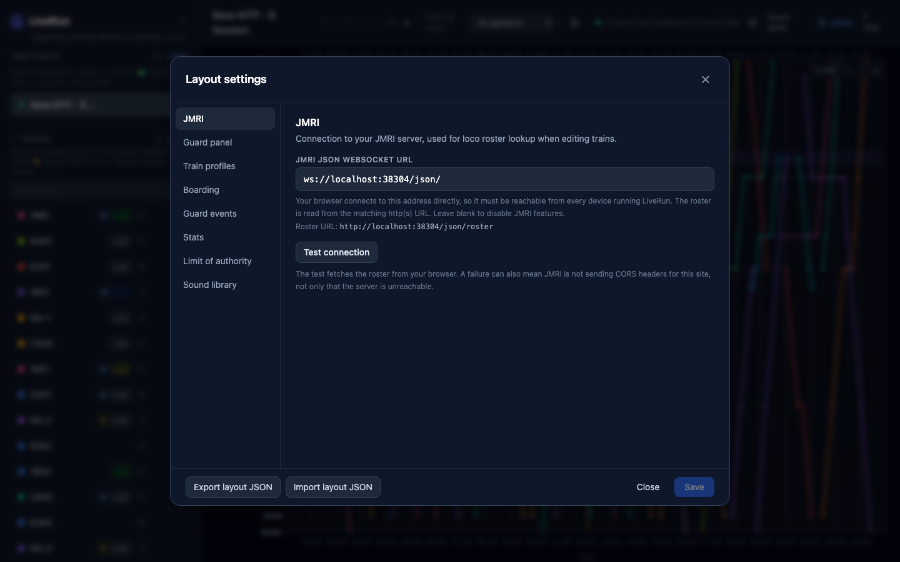
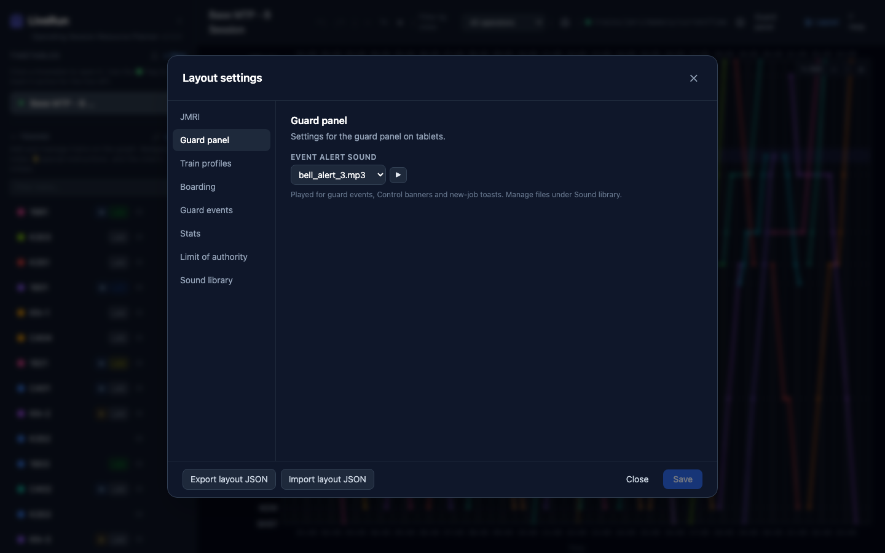
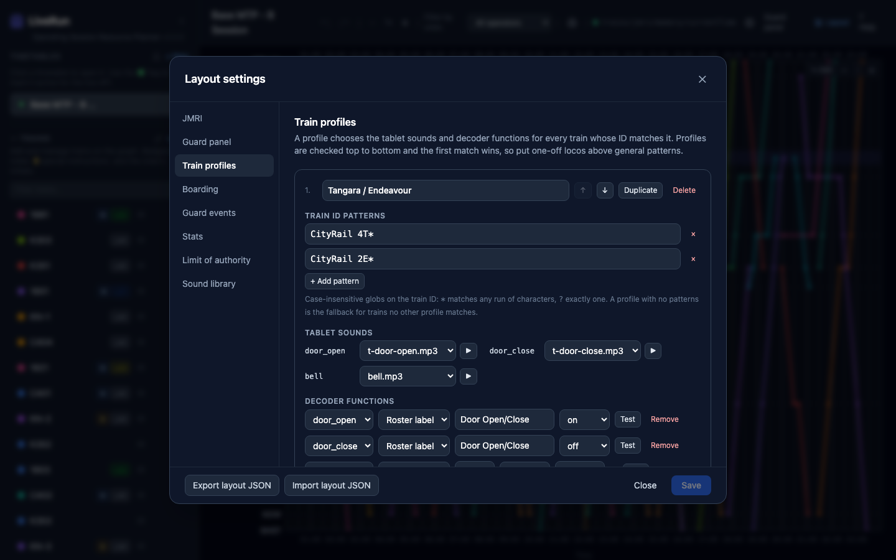
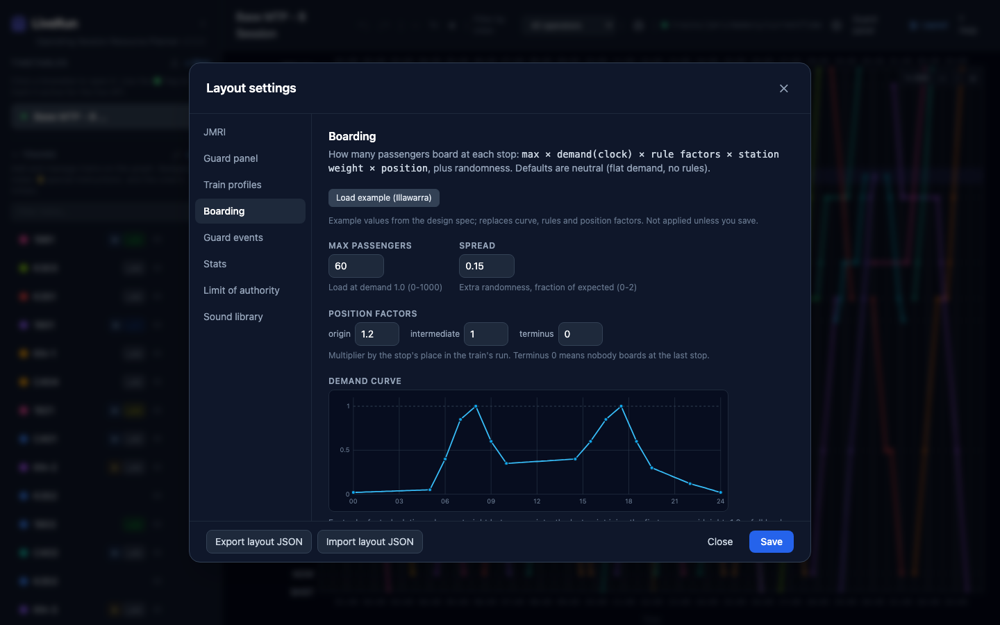
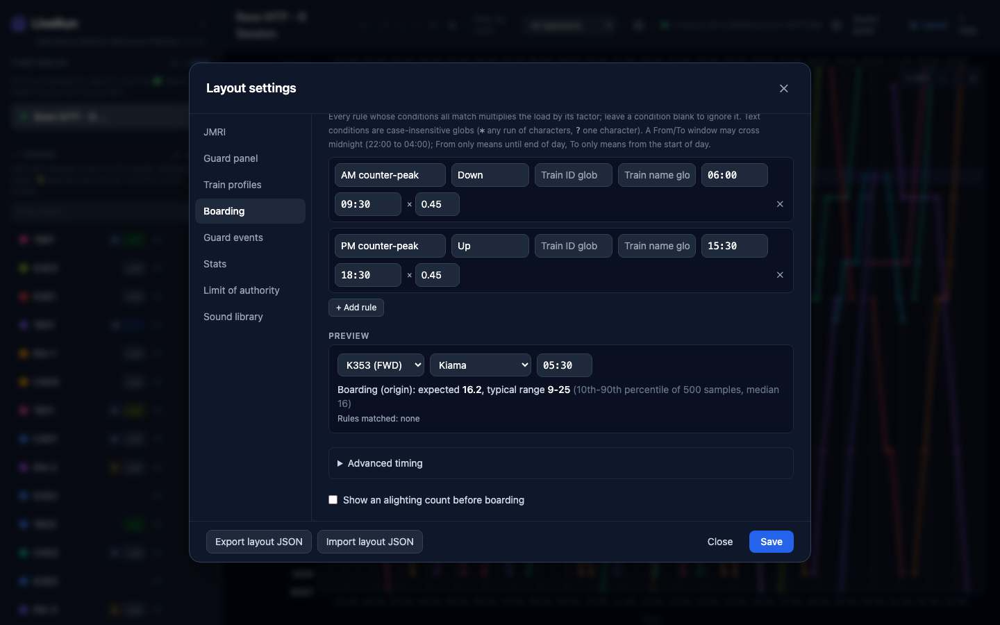
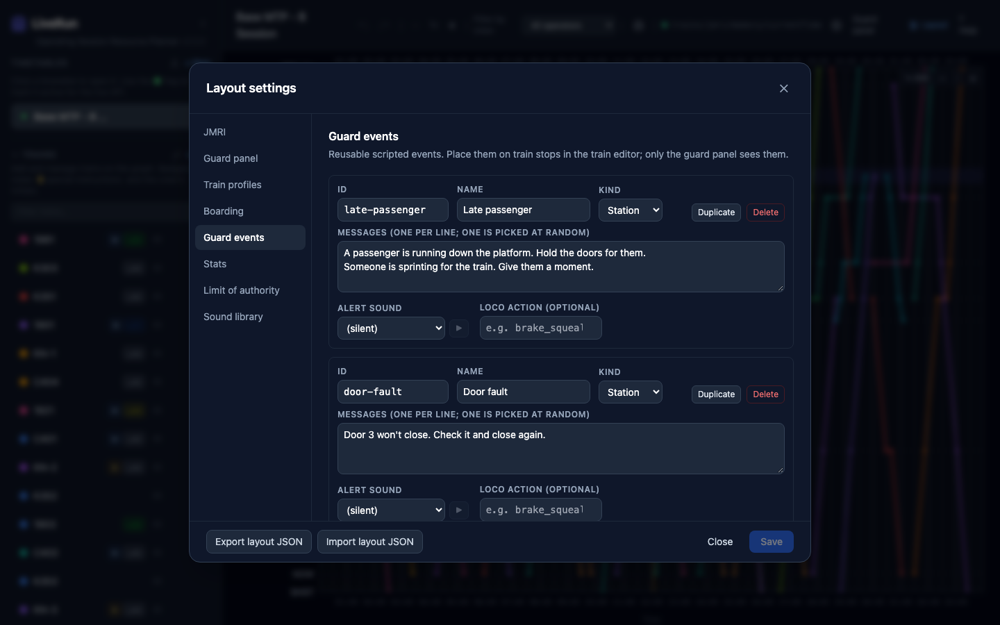
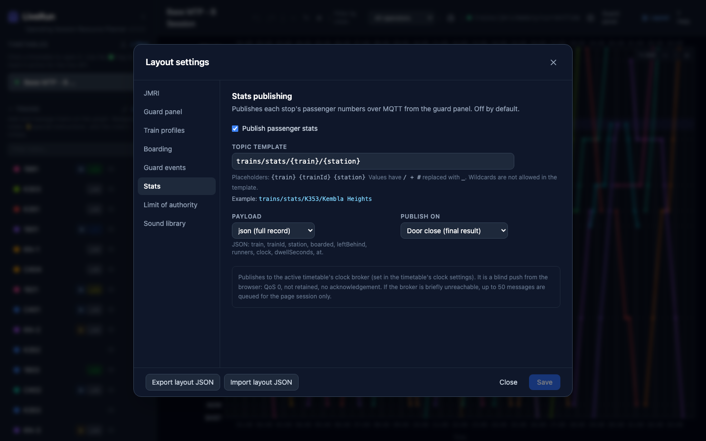
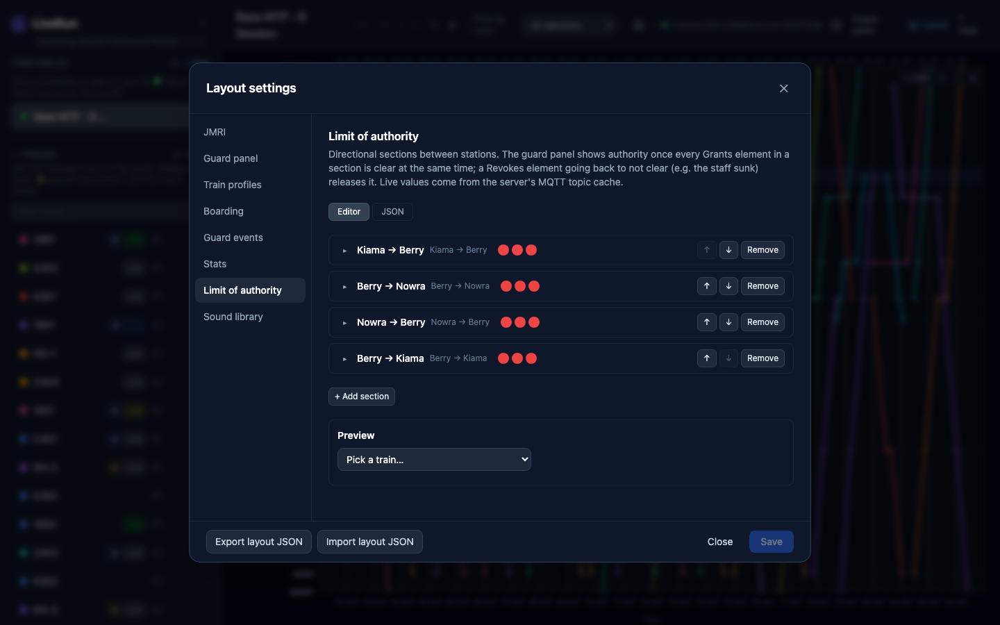
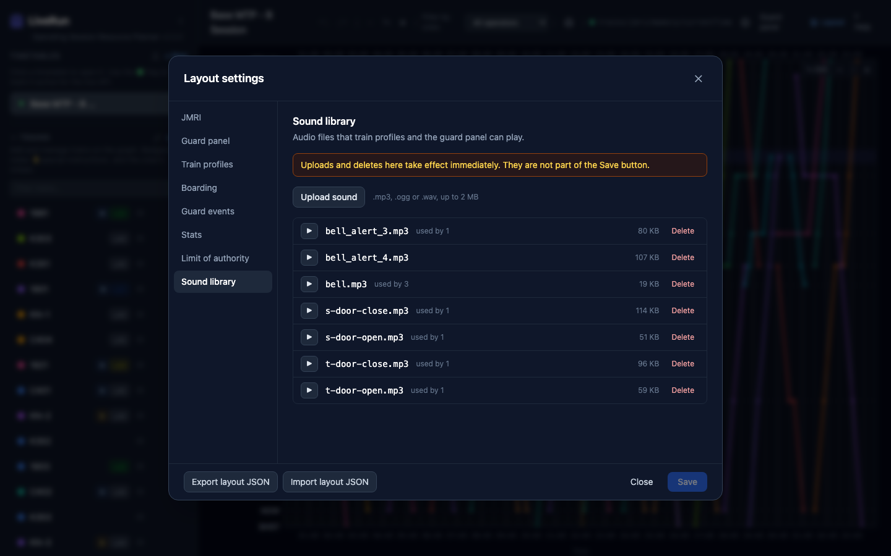

# Layout settings

**What this page is for:** the settings that belong to your layout rather than to one timetable, covering JMRI, train profiles, sounds, boarding, guard events, stats and Limit of Authority.
**Who it's for:** the layout owner.

- [Saving, exporting and importing](#saving-exporting-and-importing)
- [JMRI](#jmri)
- [Guard panel](#guard-panel)
- [Train profiles](#train-profiles)
- [Boarding](#boarding)
- [Guard events](#guard-events)
- [Stats](#stats)
- [Limit of authority](#limit-of-authority)
- [Sound library](#sound-library)

Open **Layout** in the planner's header (or ⚙ → **Layout settings…**). These settings are shared by every timetable.

## Saving, exporting and importing

- Changes are a draft until you press **Save**. **Close** asks before throwing away unsaved changes. A mistake blocks saving, and the footer says **Cannot save:** with what's wrong.
- **Export layout JSON** downloads every section as one file. Keep it with your timetable backups.
- **Import layout JSON** loads a file into the draft. Sections or fields the file doesn't have keep their current values. Nothing changes until you **Save**.
- [`docs/layout.example.json`](../layout.example.json) is a worked example (the Illawarra layout's LOA sections) to import and adapt.

> **Note** An open guard panel picks up new layout settings the next time the tablet's screen comes back on, or on **☰ → Reload**. Reload tablets after changing settings mid-session.

The **Sound library** is the exception: uploads and deletes happen immediately.

---

## JMRI

**JMRI JSON WebSocket URL**: the address of JMRI's web server JSON socket, e.g. `wss://jmri.example.net/json/` or `ws://192.168.1.20:12080/json/`. Leave it blank to turn JMRI features off.

It's used for:

- **Train ID suggestions** in the train editor, from JMRI's roster (shown under *Roster URL*);
- the **guard panel's throttle**: doors, bell and other functions on the loco.

**Every browser connects to JMRI directly**, so the address must work from every tablet and phone, not just from the LiveRun server. If LiveRun is served over HTTPS, browsers block a plain `ws://` address; use `wss://`.

**Test connection** fetches the roster from your browser. If it fails, check the address, that JMRI's web server is running, and that JMRI sends CORS headers for LiveRun's address.

---

## Guard panel

**Event alert sound**: played for guard events (unless an event has its own sound), Control's banners and new-job toasts on the guard panel. ▶ plays it here.

---

## Train profiles

A train profile decides, for every train whose **train ID** matches it:

- which **sounds** the tablet plays for door open, door close and the bell;
- which **decoder functions** the guard panel's buttons (and guard events) send to the loco through JMRI.

Locos differ: one has a sound decoder with doors on F6, another has them on F9, a freight has none. Profiles let each loco get the right behaviour without anything being built into LiveRun.

### Matching

- **Train ID patterns** are matched against the train's *train ID* (its JMRI roster name), ignoring case. `*` matches any run of characters and `?` exactly one: `CityRail 2E*` matches `CityRail 2E-2`.
- Profiles are checked **top to bottom and the first match wins**, so put one-off locos above general patterns (use ↑ ↓ to reorder).
- A profile with **no patterns** is the **fallback** for every train no other profile matches.
- A train with no profile plays no sounds and sends nothing.

The **preview** at the bottom lists the open timetable's trains with the profile each one gets (**no profile** if none). The train editor shows the same profile as a chip next to *Train ID*.

### Tablet sounds

Pick a file from the [sound library](#sound-library) for **door_open**, **door_close** and **bell** (▶ plays it). The door sounds also time the guard panel: boarding starts when the open sound finishes and DOIL goes out when the close sound finishes. Without a sound, the delays in [Boarding → Advanced timing](#advanced-timing) are used.

### Decoder functions

Each row maps an **action** to a decoder function:

| Column | Choices |
|--------|---------|
| Action | `door_open`, `door_close`, `bell`, or **custom…** (any name, e.g. `brake_squeal`, for a [guard event](#guard-events) to use) |
| Key type | **F-number** (e.g. 6) or **Roster label** (e.g. `Door Open/Close`, looked up in that loco's JMRI roster entry, so locos with different F-keys can share a profile) |
| Mode | **on**, **off**, **toggle**, **pulse** (on for *Pulse ms*, then off), **hold** (on while the button is held), **on_for** (on for *Duration seconds*) |

A typical door mapping is `door_open` → *on* and `door_close` → *off* of the same function. Mapped like that, the guard panel's DOIL follows the loco's actual state.

**No functions: nothing is sent to the decoder.** A profile with no functions is *sounds only*: the guard's buttons just play sounds.

**Test** on a row sends that function to a loco you pick from the roster (**Pick a roster loco…** → **Send**, or **Hold to send** for hold mode). Use it to check a mapping on the layout.

---

## Boarding

Boarding decides how many passengers the guard panel counts on at each stop. The defaults are neutral (the same load all day, no rules). **Load example (Illawarra)** fills in a worked example to start from; it isn't kept unless you save.

### How many board

Think of **Max passengers** as a full load. The number at any stop is that full load, made bigger or smaller by:

- **Demand curve**: how busy it is at this fast-clock time. Add points (`07:30` → `1.0`, `11:00` → `0.4`, …); LiveRun joins them with straight lines, and the last point joins the first across midnight. `1.0` is a full load.
- **Rules**: each rule whose conditions all match multiplies the load by its factor. Conditions are optional: **Direction**, **Train ID glob**, **Train name glob** and a **From**–**To** time window (which may cross midnight). For example, "Up trains between 15:30 and 18:30 × 0.45" thins out the counter-peak.
- **Station weight**: the station's *Boarding weight* in the planner (0–2; blank = 1.0). Busy stations get more.
- **Position factors**: by the stop's place in the run: **origin**, **intermediate**, **terminus**. *Terminus 0* means nobody boards at the last stop (the guard panel shows **Terminates — all alight**).

**Spread** then adds randomness, so the same train doesn't get the same count every time. Bigger spread, more variety.

### Preview

Pick a train, a stop and a time. The preview shows the stop's position, the expected count, the typical range and which rules matched. Use it to tune the numbers before a session. It follows the train's running order, the same as the guard panel.

### Advanced timing

How the count *feels* on the guard panel:

| Field | Meaning |
|-------|---------|
| **Tick (s)** | How often the counter moves |
| **Jitter** | How uneven the steps are |
| **Flow rate** | How many board per tick, on average |
| **Straggler threshold** / **Straggler rate** | Once this many are left, the flow slows to the straggler rate ("Stragglers…") |
| **Runner chance** | How likely late runners are (busier times make them more likely) |
| **Runner count** / **Runner delay (s)** | How many run, and how long until they arrive ("RUNNER") |
| **Start delay (s)** | Boarding starts this long after DOORS OPEN when the profile has no door-open sound |
| **DOIL-off delay (s)** | DOIL goes out this long after DOORS CLOSE when the profile has no door-close sound |

**Show an alighting count before boarding** adds a count of passengers getting off first. It uses the same kind of settings, with its own values (for example, lots get off at the city end in the morning).

---

## Guard events

Guard events are hidden, scripted happenings for the guard: a late passenger, a door fault, stock on the line. The library here holds reusable events; you **place** them on a train's stops in the train editor (see [Planner → Guard events on a stop](planner.md#guard-events-on-a-stop)), with a chance and timing per placement.

| Field | Meaning |
|-------|---------|
| **ID** | A short code (`a-z`, `0-9`, `-`, `_`) that placements refer to |
| **Name** | Shown in the train editor's event list |
| **Kind** | **Station** (fires at a stop, after a door moment) or **En route** (fires between two stops) |
| **Messages** | One per line; one is picked at random each time |
| **Alert sound** | Its own sound, or *(silent)* to use the [event alert sound](#guard-panel) |
| **Loco action (optional)** | An action from the loco's [train profile](#decoder-functions) to run when it fires, e.g. `brake_squeal`. Skipped quietly if the profile doesn't have it |

**Publish topic**: if set, every fired event is also published to this MQTT topic as JSON: `train`, `trainId`, `event` (its ID, or `inline`), `message`, `stop` (station events) or `section` (en-route, e.g. `Nowra → Berry`), `clock` and `at`. Blank turns it off. Like stats, it's a fire-and-forget message from the tablet over the timetable's clock broker.

How events look to the guard: [Guard panel → Guard events](guard-panel.md#guard-events).

---

## Stats

**Publish passenger stats** sends each stop's passenger numbers from the guard panel to MQTT, so a dashboard or logger can collect them. It's off by default.

| Field | Meaning |
|-------|---------|
| **Topic template** | Where to publish. Placeholders: `{train}`, `{trainId}`, `{station}` (characters `/ + #` in their values become `_`). The example under it shows a real topic |
| **Payload** | **count (plain integer)**, or **json (full record)**: train, trainId, station, boarded, leftBehind, runners, clock, dwellSeconds, at |
| **Publish on** | **Door close (final result)** or **Boarding start (initial count)** |

Messages go to the active timetable's clock broker from the tablet: not retained, no acknowledgement. If the broker is briefly unreachable, up to 50 are queued while the page stays open.

---

## Limit of authority

Directional sections between stations, each with the signals, staffs and other conditions that must be clear before a train has authority. This has its own page: **[Limit of authority](limit-of-authority.md)**.

---

## Sound library

Audio files that train profiles and the guard panel can play. **Upload sound** accepts `.mp3`, `.ogg` or `.wav` up to 2 MB. ▶ plays a file; *used by n* shows how many places use it. **Delete** asks first, and warns if a file is in use.

> **Important** Uploads and deletes take effect immediately. They are not part of **Save**.

LiveRun starts with a few sounds (door open/close for two kinds of train, a bell and two alert tones).

---

Last checked against v2.1.0.
