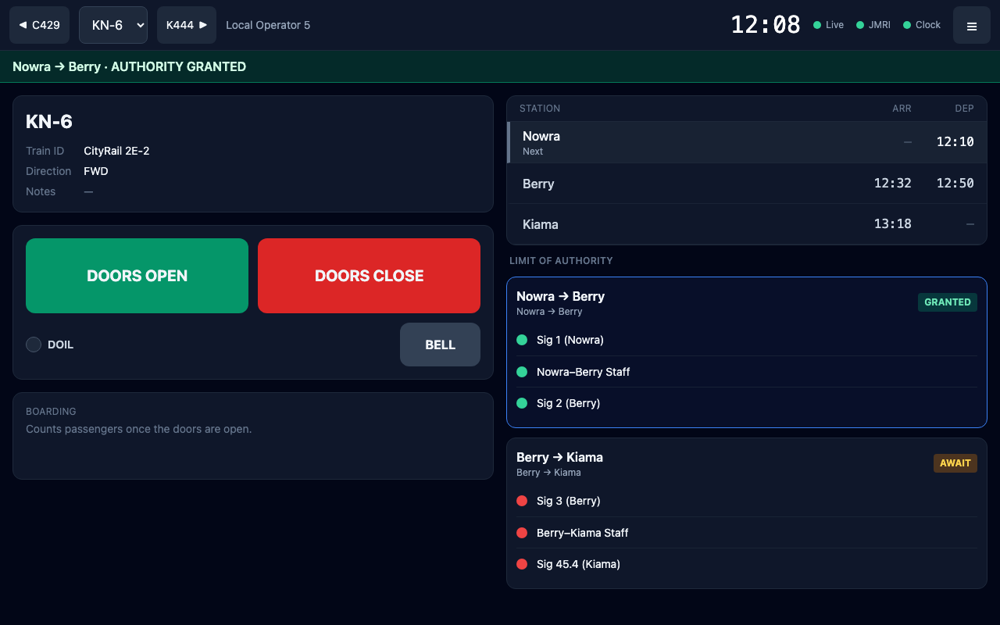
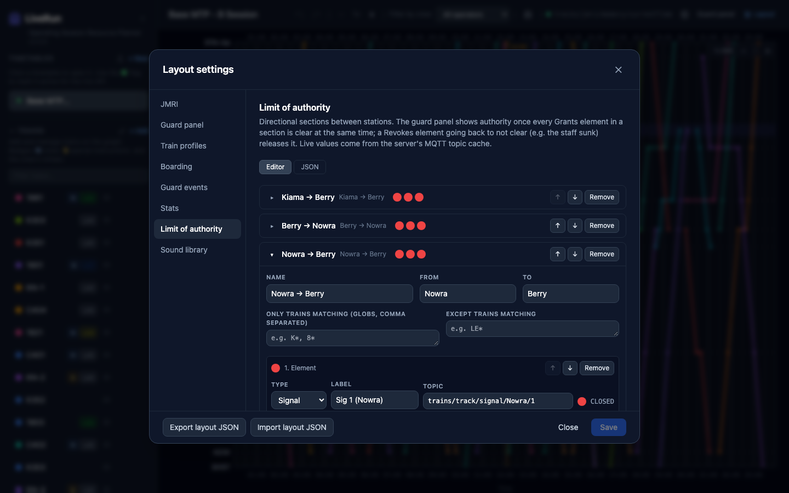
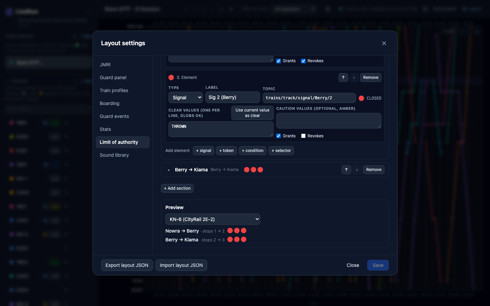

# Limit of authority

**What this page is for:** how Limit of Authority (LOA) works, how to set it up, what the guard sees, and the rules for operating with it.
**Who it's for:** the layout owner and Control; guards should read [What the guard sees](#what-the-guard-sees) and [Operating rules](#operating-rules).

- [The idea](#the-idea)
- [Sections and which trains get them](#sections-and-which-trains-get-them)
- [Elements](#elements)
- [Grant and release](#grant-and-release)
- [What the guard sees](#what-the-guard-sees)
- [Setting it up](#setting-it-up)
- [Worked example: KN-6, Nowra to Kiama](#worked-example-kn-6-nowra-to-kiama)
- [Operating rules](#operating-rules)

## The idea

On a real railway a train needs an authority before it may enter a section of line: a clear signal, a staff in the driver's hand, and so on. LiveRun shows a guard whether their train has that authority, using the **real state of your layout's signalling**. Signals, staffs and other conditions publish their state to MQTT (from JMRI, CATS or anything else). LiveRun watches those topics and turns them into **AWAIT** or **AUTHORITY GRANTED** on the guard panel.

LOA is driven **only by the safeworking elements you configure**. The doors, the guard's pinned stop and the fast clock play no part. Doors aren't a safeworking element and are never interlocked with LOA in either direction. There's no reset button on the tablet: Control governs LOA entirely through the signalling.

LOA appears on the guard panel only (not in the crew view). On layouts where one person drives and guards, that's the same person.

## Sections and which trains get them

A **section** is one-way, **from** one station **to** another, e.g. *Nowra → Berry*. The other direction is a separate section with its own elements (*Berry → Nowra*).

A train gets a section when its route (its stops in running order) goes from the *from* station to the *to* station, with or without stops in between. A train that runs Nowra → Berry → Kiama gets *Nowra → Berry* then *Berry → Kiama*; an out-and-back working gets each direction in turn. Station names are matched ignoring case.

To limit a section to some trains, use **Only trains matching** and **Except trains matching**: comma-separated patterns (`*` and `?`) tested against the train ID and the train name. Either matching counts. Leave both blank for every train.

The guard panel shows a train's sections in the order it reaches them.

## Elements

Each section lists the elements that make up its authority. Each element watches one MQTT topic:

| Type | Typical use | Released by default when it goes back to not clear? |
|------|-------------|------|
| **Signal** | A signal or signal mast | No |
| **Token** | A staff, tablet or other token | **Yes** (the staff is returned at the far end) |
| **Condition** | Anything else: a points position, a track circuit, a block instrument | No |
| **Selector** | Picks *which* element applies from another topic, e.g. a turnout choosing between two departure signals | — |

For signals, tokens and conditions you list the payloads that count as **clear** (one per line; `*` and `?` allowed) and, optionally, **caution** values (clear, shown amber). Any other value counts as **stop**. Before any value has been received, the element has **no data**.

A **selector** watches its own topic (e.g. `trains/track/turnout/Kiama/Down Loop/State`) and maps each value it can read to a signal or condition (**When selector reads** `CLOSED` → *Sig 45.25*, `THROWN` → *Sig 45.27*). The **Default** option applies until the selector topic has a value. The guard sees the label of whichever one applies.

## Grant and release

Each element has two tick boxes:

- **Grants** (ticked by default): the element must be clear for the section to be granted.
- **Revokes** (ticked by default for tokens only): the element going back to not clear **releases** the authority.

**A section is GRANTED when every Grants element is clear at the same moment.** One clear, then another, then the first going back to stop doesn't add up to a grant; they must all be clear together. Once granted, the authority **holds** even when signals go back to stop behind the train. It's like a driver who has passed a signal still holding their authority.

**A section is COMPLETE when a Revokes element returns to not clear** after having been clear since the grant (e.g. the staff is put back in the instrument at the far end). The panel moves on to the next section. A completed section is **never granted again** on that run, so a following train getting the same staff can't bring it back.

An element that was already at stop when the section was granted can't release it straight away; it has to be seen clear first.

Later sections can be granted early, before the train reaches them, if Control sets them up ahead. Only the first open occurrence of a section can be granted; the same section later in an out-and-back run waits its turn.

The editor warns about two set-ups that can't work:

- **No element is ticked Grants, so this section can never be granted.** The same goes for a section with no elements at all; the editor shows *No elements yet. A section is never granted until it has at least one element ticked Grants.*
- **No element is ticked Revokes, so once granted this section is never released and the guard panel stays on it.**

## What the guard sees

**The strip** under the guard panel's header shows the current section (the first one not complete):

| Strip | Means |
|-------|-------|
| grey: **Nowra → Berry · waiting for signal data: Sig 1 (Nowra), …** | No value yet for the listed elements |
| amber: **AWAIT: Sig 1 (Nowra), Nowra–Berry Staff, Sig 2 (Berry)** | Not granted. It lists the elements that aren't clear yet |
| green: **Nowra → Berry · AUTHORITY GRANTED** | Granted |
| **All sections complete** | Every section on the run has been released |
| **Limit of authority: no sections for this train** | The route has no LOA sections |

**The Limit of authority list** (right column, under the stops) shows every section on the run with its badge (**NO DATA**, **AWAIT**, **GRANTED**, **COMPLETE**) and a dot per element: green clear, amber caution, red stop, grey **?** no data. The current section has a blue outline; completed ones are dimmed.

Only dots and labels are shown, never raw MQTT values. The guard needs to know *whether* Sig 2 is clear, not what JMRI calls its aspect.

## Setting it up

Open **Layout → Limit of authority**.

1. **+ Add section.** Give it a **Name**, a **From** and **To** station (names as in your timetables) and, if needed, *Only* / *Except* patterns.
2. **Add element**: **+ signal**, **+ token**, **+ condition** or **+ selector**. For each, set a **Label** (what the guard reads) and the **Topic**.
3. **Clear values.** Next to the topic you'll see the element's live value and dot. Set the real signal or staff to its clear state on the layout, then press **Use current value as clear** to add exactly what your system sends. Add **Caution values** if you have them.
4. Check **Grants** and **Revokes** for each element.
5. Use ↑ ↓ to order sections and elements (the guard sees elements in this order).
6. **Preview**: pick a train to see which sections it gets, in its running order, with live dots.

   

7. **Save.** Reload tablets that already have the guard panel open.

The **JSON** tab shows the LOA settings as JSON for copying between layouts or bulk editing. **Apply** puts your edit into the draft; **Save** checks and stores it. [`docs/layout.example.json`](../layout.example.json) has four complete sections to import and adapt.

**Where the values come from:** the LiveRun server subscribes to every LOA topic on the **active timetable's clock broker** (the timetable's fast-clock settings) and remembers the last value of each. A tablet that reloads gets the current values straight away instead of waiting for the next change. If an element stays grey, its topic hasn't published anything since the server started. Make your signalling publish retained messages, or change the element once.

## Worked example: KN-6, Nowra to Kiama

The example layout has four sections: *Kiama → Berry*, *Berry → Nowra*, *Nowra → Berry* and *Berry → Kiama*. KN-6 runs Nowra 12:10 → Berry 12:32/12:50 → Kiama 13:18, so it gets **Nowra → Berry** and **Berry → Kiama**.

*Nowra → Berry* has three elements: **Sig 1 (Nowra)** (signal, clear when `THROWN`), **Nowra–Berry Staff** (token, clear when `CATS`) and **Sig 2 (Berry)** (signal, clear when `THROWN`).

| Step | On the layout | The guard sees |
|------|---------------|----------------|
| 1 | The guard opens KN-6 at Nowra. Signals at stop, staff in its instrument | **AWAIT: Sig 1 (Nowra), Nowra–Berry Staff, Sig 2 (Berry)**, red dots |
| 2 | Control sets up the road: Sig 2 off, staff out, Sig 1 off | The dots go green one by one. When the last one clears, all three are clear together: **Nowra → Berry · AUTHORITY GRANTED** |
| 3 | KN-6 departs; Sig 1 returns to stop behind it | Still **GRANTED** (signals don't release) |
| 4 | At Berry the staff goes back into the instrument (not `CATS`) | *Nowra → Berry* is **COMPLETE**; the strip moves on to **AWAIT** for *Berry → Kiama* |
| 5 | Control sets up Berry → Kiama | **Berry → Kiama · AUTHORITY GRANTED** |
| 6 | The Berry–Kiama staff is returned at Kiama | **All sections complete** |

## Operating rules

> **Important** **Open the train on the guard panel before Control starts setting up its first section.** A tablet only knows about grants and releases it saw happen. A tablet that picks a train up mid-run never saw its earlier sections granted, so it can't see them released either: the first section shows **AWAIT** and the strip stays on it.

- **LOA is guard panel only.** The crew view doesn't show it.
- **There is no manual reset.** Control governs LOA through the signalling.
- **A tablet remembers each train's LOA state for 12 hours** after it last changed, so a reload mid-session keeps it. Running the same timetable the next week starts clean.
- **The doors don't matter.** Opening or closing doors, pinning a stop or the clock time never grants or releases anything.

See also [Troubleshooting → Limit of authority](troubleshooting.md#limit-of-authority).

---

Last checked against v2.0.0.
