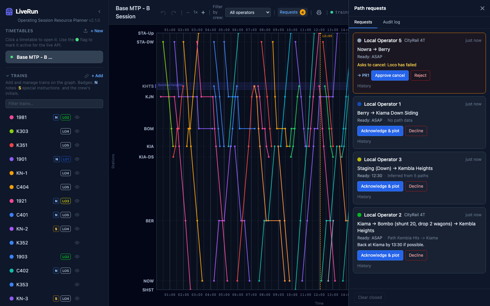
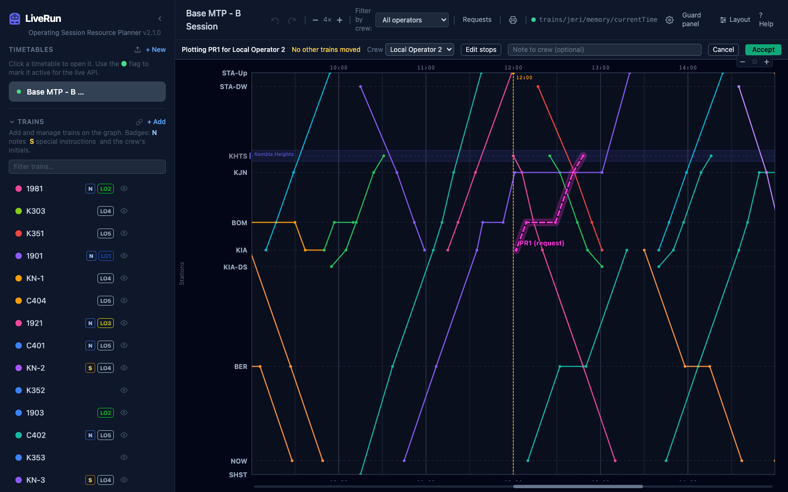
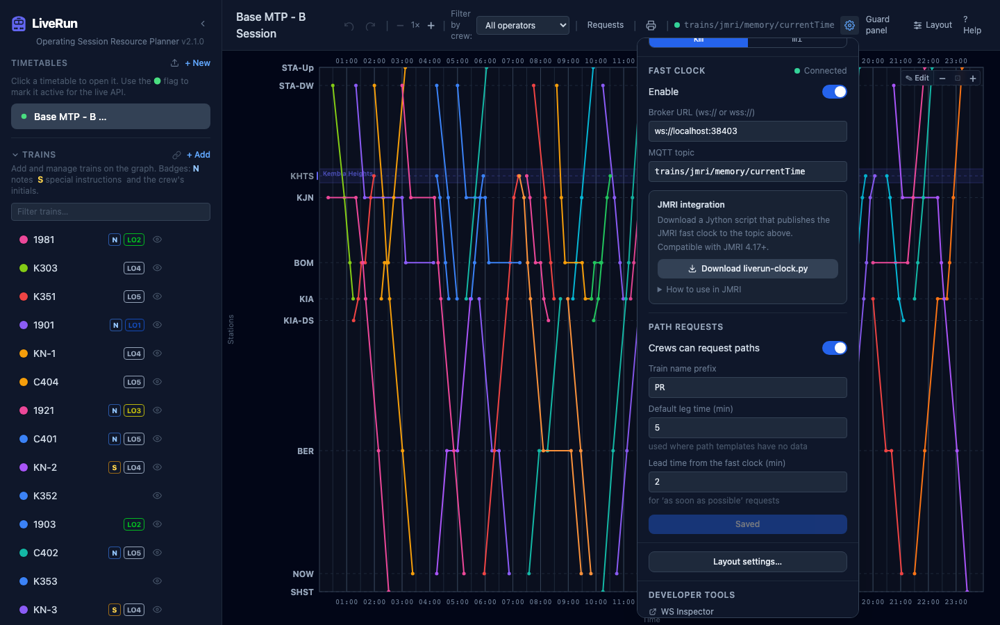
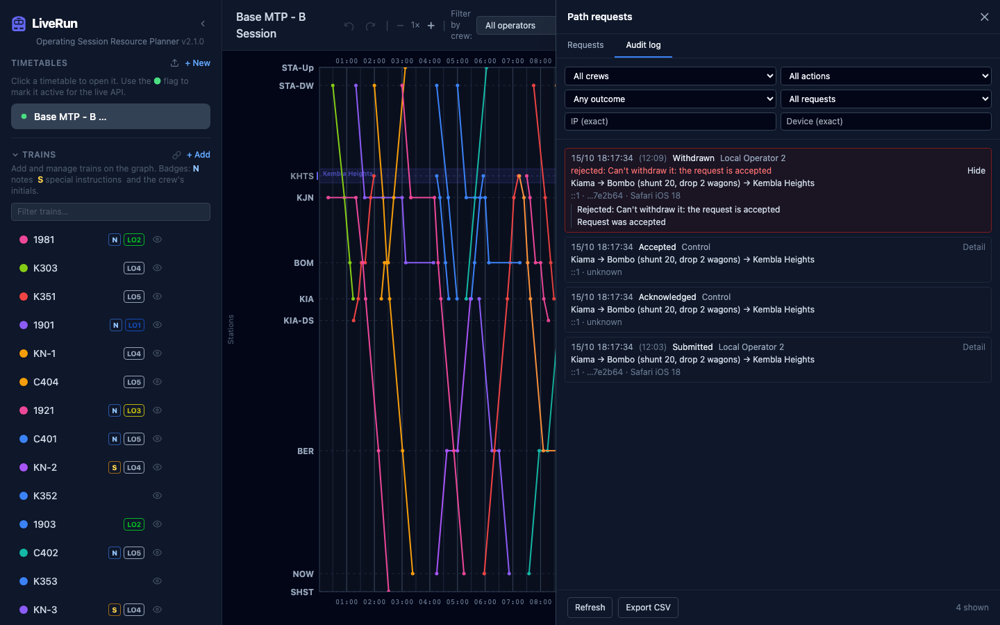

# Path requests

**What this page is for:** how a crew's request for a path becomes a train on the graph, from both sides, and what LiveRun records about it.
**Who it's for:** Control, and crews who want to know what happens after they tap **Send request**.

- [How a request travels](#how-a-request-travels)
- [Handling requests in the planner](#handling-requests-in-the-planner)
- [Plotting a request](#plotting-a-request)
- [Where the times come from](#where-the-times-come-from)
- [Undo and requests](#undo-and-requests)
- [Asks to cancel](#asks-to-cancel)
- [Settings](#settings)
- [Audit log](#audit-log)

A **path request** is a crew asking for a train to be plotted for them: from where they are, through any stops or shunts, to where they want to go. Crews send it from [Crew jobs](crew-jobs.md#requesting-a-path). Control reviews it in the planner, plots it on the graph and accepts it, and the new train appears in the crew's jobs.

Requests go to the **active timetable** only, and only while **Crews can request paths** is on in [Settings](#settings). The timetable holds up to 50 open requests at a time.

## How a request travels

| Status | Crew sees | Control sees | Moves on when |
|--------|-----------|--------------|---------------|
| **Pending** | **Waiting** | In the drawer, counted in the **Requests** badge | Control picks **Acknowledge & plot** or **Decline**; the crew can **Withdraw** |
| **Plotting** (in review) | **Plotting** | **Plotting**, with **Resume plotting** and **Return to queue** | Control accepts or declines, or returns it to pending; the crew can **Withdraw** |
| **Accepted** | The job, badged **Accepted** | Nothing: it leaves the drawer and is now a train | The crew asks to cancel (it comes back to the drawer until you decide) |
| **Declined** | **Declined** and Control's reason, for 10 minutes | Nothing: it leaves the drawer | — |
| **Withdrawn** | Nothing: it disappears | Nothing: it leaves the drawer (with a toast) | — |
| **Cancelled** | Nothing: the job disappears | Nothing | — |

Every request, settled or not, stays in the [audit log](#audit-log). If an accepted request's train is deleted (or the accept undone), the request drops out of the drawer and the crew's list too.

## Handling requests in the planner

When a crew sends a request, a toast appears: **Local Operator 2 requests a path: Kiama → Kembla Heights**, with a **Review** button that opens the drawer at that request. Crews withdrawing a request, or asking to cancel a train, get a toast too.

The **Requests** button in the planner header opens the drawer. It lists only what still needs you: pending requests, ones being plotted, and accepted ones the crew has asked to cancel. A number badge counts the pending ones plus the asks to cancel. The button shows while the timetable is active, or while it still has requests.

Each row shows the crew, the loco, how long ago it was sent, the route (with shunt and work stops and their notes), **Ready** (a time or **ASAP**), the crew's notes, and a **times from** line saying where plotting will get its running times (see [Where the times come from](#where-the-times-come-from)). Rows with a cancel ask are outlined in amber.

What you can do depends on the request's state:

| State | Buttons |
|-------|---------|
| Pending | **Acknowledge & plot**, **Decline** |
| Plotting | **Resume plotting**, **Return to queue**, **Decline** |
| Accepted, with an ask to cancel | A link to the train (hover it to highlight the train on the graph), **Approve cancel**, **Reject** |

**Decline** needs a reason; the crew sees it on their card. Each row's **History** shows what has been done to that request; see [Audit log](#audit-log).

## Plotting a request

**Acknowledge & plot** moves the request to **Plotting** (the crew sees it straight away), closes the drawer, and draws a draft train on the graph: a thick dashed line with moving dashes and a pulsing glow, in a bright colour picked to differ from the trains already on the graph, labelled with its name and **(request)**. The accepted train keeps that colour. Nothing is saved yet: the draft is not in the timetable until you accept it. You can plot one request at a time.

The graph switches to edit mode and the **plotting bar** appears above it:

| Control | Does |
|---------|------|
| **Plotting PR1 for Local Operator 2** | The draft train's name (from [Settings](#settings)) and the crew that asked |
| **No other trains moved** / **n other trains moved** | Counts other trains you've dragged while plotting, for example to make room |
| **Train** | The train number the accepted train gets. It starts as the next free **Train name prefix** number (PR1, PR2, …); type the real one, e.g. **8982**. **Accept** needs one, and a warning appears if another train already has it |
| **Crew ▾** | Who the train goes to. It starts as the crew that asked; **Unassigned** is allowed. The train keeps its colour |
| **Edit stops** | Opens the train editor on the draft, to change stops, times, notes or the train's name |
| **Note to crew (optional)** | A note the crew sees on their request card, up to 300 characters |
| **Cancel** | Throws away the draft and every move, and returns the request to pending |
| **Accept** | Saves the train and any moves of other trains, and marks the request accepted |

Drag the draft train, or one of its dwell handles, as you would any train in [graph edit mode](planner.md#move-trains-on-the-graph). You can also move other trains to make room. Dragging never changes running times.

Warnings appear under the bar, in amber. They don't stop you accepting:

- A leg timed from timetabled trains: **Berry → Shoalhaven Starches: no path template, 22 min from 5 timetabled trains**. Check it looks right.
- A leg with no data at all: **Bombo → Dunmore: no path or timetable data, 5 min used**.
- **starts n min before the fast clock**: the draft begins in the past.
- **Local Operator 2 has another job overlapping 12:10–13:00**: the chosen crew is already busy.

If the crew **withdraws** while you're plotting, the bar says **Local Operator 2 withdrew this request**, **Accept** is disabled and your drafts stay on the graph until you **Cancel**. If you reload the page while plotting, the draft is lost but the request stays in **Plotting**: use **Resume plotting** in the drawer to start again. If the request leaves review some other way (you returned or declined it from another window), plotting closes.

**Accept** makes the train, applies any moves to other trains, and sends your note to the crew. The crew gets a **Path accepted → PR1** toast and a **New job** notice. If another train you moved was changed by someone else in the meantime, the accept is refused and your drafts are kept: accept again, or cancel.

## Where the times come from

The draft is timed from the timetable's [path templates](planner.md#paths-route-templates). Where no template reaches a station, it falls back to the running times of the timetable's own trains between their consecutive stops. The drawer's **times from** line says what plotting will use:

| Line | Meaning |
|------|---------|
| **Path Kiama–Bombo** | Every requested station lies in order on one path template, forwards or in reverse. Its running times are used |
| **Inferred from 2 paths** | No single path covers the route, so the fastest chain of path legs between the stations is used (where paths overlap, their median time) |
| **Inferred from 10 paths + 5 timetabled trains** | No chain of paths reaches every requested station, so the gaps are filled from timetabled trains: the median time of the trains that run between those two stops, in either direction. Path data always wins where it exists, and the route uses as few train-timed legs as it can. Trains made from path requests are never used |
| **From 8 timetabled trains** | No path reaches the stations at all; every leg is timed from timetabled trains |
| **No path or timetable data** | No path and no timetabled train links the requested stations. Each leg uses the **Default leg time** from [Settings](#settings) |
| a line ending **⚠ Bombo → Dunmore: no path or timetable data** | Some legs had no data at all and used the default leg time |

Stations the train passes between the requested stops are included as timing points with no dwell. The start time is the **Ready** time if it hasn't already passed on the fast clock; otherwise the fast clock plus the **Lead time** setting; with no fast clock, the timetable's start time. A **Stop** with minutes on site becomes a dwell (at least a minute); **Shunt** and **Work** stops become a dwell plus a special instruction.

## Undo and requests

Requests don't follow undo and redo. Undoing never brings a declined request back or removes an accepted one, and request buttons (**Decline**, **Return to queue**, and so on) aren't undo steps.

**Accept** is one undo step: undoing it removes the new train and puts back any trains you moved. The request stays accepted but, with no train, drops out of the drawer and the crew's list; redo brings the train back. If the crew still needs the path, they send a new request.

## Asks to cancel

A crew can ask to cancel an accepted request. The drawer row turns amber and reads **Asks to cancel**, with their reason, the **Requests** badge counts it, and a toast appears.

- **Approve cancel** asks for an optional note, then **Approve and delete train** removes the train and marks the request **Cancelled**. This deletes the train for good, and isn't an undo step.
- **Reject** asks for a note (required, so the crew knows why). The train stays, and the crew can ask again.

## Settings

⚙ → **Path requests** (per timetable; press **Save changes**):

| Setting | Default | Does |
|---------|---------|------|
| **Crews can request paths** | On | Turns **+ Request a path** on or off for crews. Turning it off doesn't touch requests already made |
| **Train name prefix** | `PR` | Names new trains `PR1`, `PR2`, … using the lowest number not in use. Up to 8 letters, digits or hyphens |
| **Default leg time (min)** | 5 | Running time for legs where no path has data (1 to 120) |
| **Lead time from the fast clock (min)** | 2 | How long after the fast clock a train that's ready "as soon as possible" starts (0 to 60) |

## Audit log

Everything that happens to a request is written to an append-only log, so that Control can see what happened, when, and from which device. This includes refused attempts.

Each entry records:

- **Time**, and the **fast clock** reading the phone had at that moment, if it was running
- **Who**: **Control** or the crew named in the request
- **What**: Submitted, Withdrawn, Acknowledged, Released (returned to the queue), Declined, Accepted, Asked to cancel, Cancel approved, Cancel rejected or Cleared closed
- **Outcome**: OK, or **rejected** with the reason (for example, a withdraw after the request was accepted)
- **IP address**, **device id** (a random id each phone keeps), and **browser** (for example *Safari iOS 18*)
- The details: the route, what the accepted train looked like, which trains were moved and how, and the notes

> **Note** There are no logins in LiveRun, so the crew is whatever the phone said it was. The log shows which device, address and browser said it, which is usually enough to see who did what on a trusted layout network. It can't prove who was holding the phone.

**Where to find it:**

- **History** on a request row shows the entries for that request, newest first.
- The drawer's **Audit log** tab shows everything for the timetable, newest first, 200 at a time (**Load older** for more). Each entry expands with **Detail**. Narrow it with the filters: **crew**, **action**, **outcome** (OK or rejected), **request**, **IP** and **device** (the last two match exactly).
- **Export CSV** downloads what the filters currently show (up to 1000 entries) as `path-request-audit.csv`, for a spreadsheet.

**On disk:** entries go to `audit.jsonl`, one per line, in the server's data folder (next to the timetable database, `server/data/` by default, or the folder of `DB_PATH`). It is separate from the timetable, so undo, deleting a timetable and restoring a backup don't touch it. At 5 MB the file is renamed `audit.1.jsonl` and a new one starts, so about the last two files' worth are kept. Back up the data folder to keep the log.

---

Last checked against v2.1.0.
