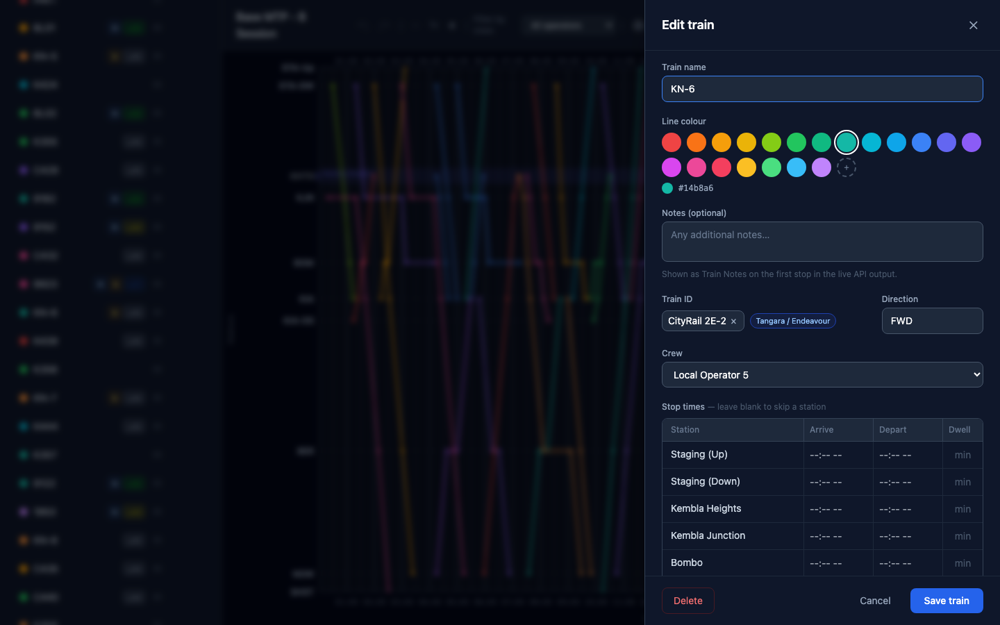
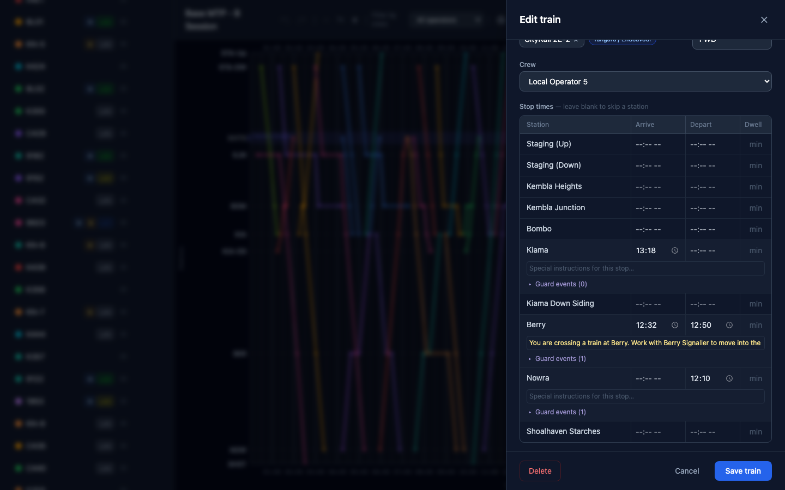
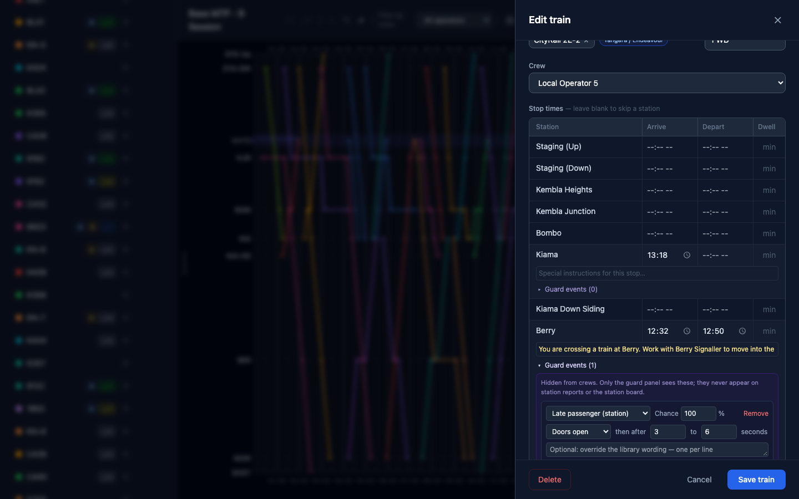
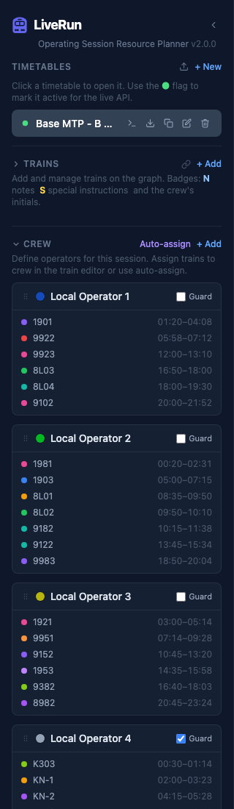
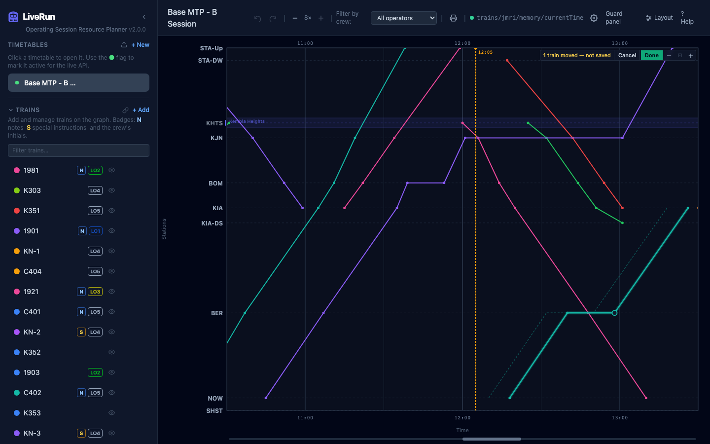
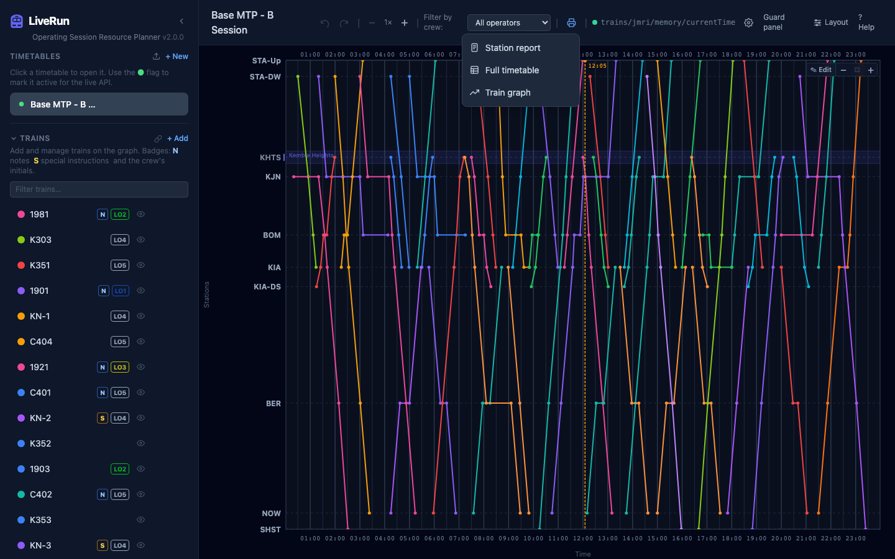
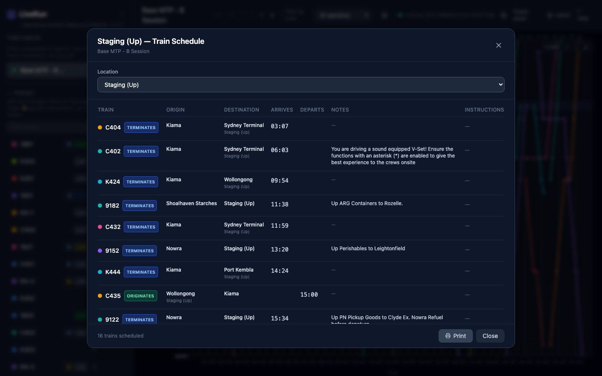
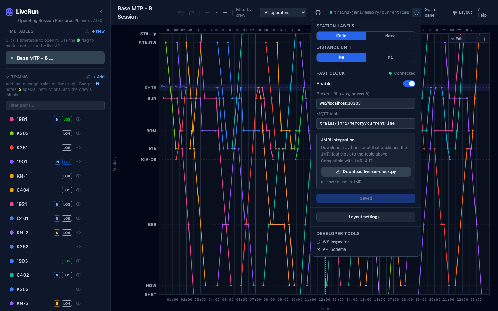

# The planner

**What this page is for:** building and maintaining timetables on a desktop or laptop, including stations, paths, trains, crews, the train graph and printing.
**Who it's for:** the layout owner and Control.

- [Timetables](#timetables)
- [Stations](#stations)
- [Paths (route templates)](#paths-route-templates)
- [Trains](#trains)
- [Crews](#crews)
- [The train graph](#the-train-graph)
- [Move trains on the graph](#move-trains-on-the-graph)
- [Undo and redo](#undo-and-redo)
- [Printing](#printing)
- [Settings and the fast clock](#settings-and-the-fast-clock)

The planner opens at the app's root URL on a desktop browser (add `?desktop` to force it on any device). The sidebar on the left lists **Timetables**, **Trains**, **Crew**, **Stations** and **Paths**. Click a section's heading to fold it away. Drag the sidebar's right edge to make it wider or narrower (double-click the edge to reset); the ‹ button (**Collapse sidebar**) folds it away entirely. The header across the top holds undo/redo, zoom, the crew filter, printing, the fast-clock indicator, ⚙ settings, **Guard panel** (opens the guard panel in this browser), **Layout** and **? Help** (this guide).

---

## Timetables

A timetable is one operating session: its stations, trains, paths and crews, plus a time window for the graph.

**Create one:** click **+ New** under *Timetables*. Give it a name, an optional description and the **Graph start time** / **Graph end time** (the span of the time axis). Stations and trains are added afterwards.

> **Note** The description is shown under the timetable's name in the crew view's timetable list. Use it as the operating brief for the session (crew numbers, extras, special arrangements).

**Open one:** click its name. The open timetable shows a row of icons (hover one for its name):

| Icon | Does |
|------|------|
| **Export timetable as CATS XML** (`>_`) | Two files for CATS; see [Integrations → CATS XML export](integrations.md#cats-xml-export) |
| **Export timetable as JSON** | A complete backup you can import later |
| **Duplicate timetable** | A copy to start a new session from |
| **Edit timetable settings** | Name, description, time window |
| **Delete timetable** | Asks first; cannot be undone |

**Import:** the upload icon next to **+ New** (**Import timetable from JSON**) loads a JSON export as a *new* timetable; it never overwrites an existing one.

### The active timetable

The dot before each timetable name is its **active** flag. Click it to make that timetable active (🟢); click again to clear it. Only one timetable is active at a time.

The active timetable is the one the session runs on:

- the **guard panel** and **crew view** follow it (and tell their users when Control switches to another one);
- the **live API**, station boards and the Limit of Authority topic cache use it.

---

## Stations

Under **Stations**, click **+ Add**. Each station has:

| Field | Meaning |
|-------|---------|
| **Station name** | As shown everywhere (required) |
| **Code** | Short code for graph labels and reports, e.g. `KJN` |
| **Position** | **Graph position**: where the station sits on the graph's vertical axis, and the order stations are listed in (required) |
| **km label** | Optional distance shown next to the name. It is a label only and doesn't affect spacing. ⚙ settings can show the unit as mi instead of km (the number isn't converted) |
| **Branch name** | Stations that share a branch name are grouped and shaded together on the graph |
| **Allow per-train location alias** | Lets a train's stop here show a different name (see [Location alias](#stops)) |
| **Boarding weight** | 0–2, blank = 1.0. Scales how many passengers board here on the guard panel (see [Layout settings → Boarding](layout-settings.md#boarding)) |
| **Name style** | **B** / *I* / U for the graph labels and printouts. A station with none set is shown bold |

**Inserting a station mid-line:** tick **Shift stations below by position delta** when you add or move a station. Every station at or below the new position moves down to make room, so you don't have to renumber them by hand.

> **Note** Graph position and the km label are independent. Spacing on the graph comes only from graph position.

---

## Paths (route templates)

A path is a reusable stopping pattern with running times, so you don't type every stop time by hand.

Under **Paths**, click **+ Add**, name the path, then add stations in the order the train runs. For each stop set **Travel time from prev (min)** (ignored for the first stop) and **Dwell time (min)**; use the arrows to reorder.

To use one, pick it under **Path (optional)** at the top of the train editor. The stop list narrows to the path's stations; enter the first departure and press the auto-fill button (**Auto-fill stops from first departure using path timings**) to fill in every stop.

---

## Trains

Under **Trains**, click **+ Add** (or click any train to edit it). The graph previews your changes live while the editor is open; nothing is saved until **Save train**. **Cancel**, ✕ or **Escape** close the editor (it asks first if you've changed something).

| Field | Meaning |
|-------|---------|
| **Path (optional)** | A route template to pre-fill stops (above) |
| **Train name** | The train's number or name, e.g. `KN-6` |
| **Line colour** | Its colour on the graph (12 presets or a custom colour) |
| **Notes (optional)** | Shown in tooltips, on station reports, in the crew view and the guard panel, and as *Train Notes* in the live API |
| **Train ID** | The loco's **JMRI roster name**. When a JMRI URL is set in [Layout settings](layout-settings.md#jmri), you get suggestions from the roster (an entry that isn't in the roster is marked *not in roster*, but still saves). The guard panel drives this loco, and the matching [train profile](layout-settings.md#train-profiles) is shown as a chip |
| **Direction** | Free text, e.g. `Up`, `Down`, `FWD`. Shown on the guard panel; [boarding rules](layout-settings.md#boarding) can match it. (The live API's up/down filter works direction out from station order instead) |
| **Crew** | Who works the train (**— Unassigned —** for nobody) |

### Stops

Every station is listed in station order. Leave a station blank to skip it. For each stop:

- **Arrive** / **Depart**. The first stop is departure only and the last is arrival only (the fields are disabled). A stop with the same arrival and departure is a **pass** (the train runs through).
- **Dwell** (minutes). Changing it recalculates the departure. Changing a departure or dwell moves every later stop by the same amount, so running times are kept.
- **Special instructions**: a public note for this stop. It's printed on station reports and appears in the live API and on station boards. The guard panel never shows it.
- **Alias…** (only at stations that allow it): a different name for this train's stop here. For example, a staging road can stand in for "Sydney Terminal". Reports, tooltips and the guard panel show the alias, with the real station underneath.
- **Guard events (n)**: hidden, scripted events for the guard panel. See [below](#guard-events-on-a-stop).

> **Note** Stops are stored in station order, so an Up train is listed bottom to top. The guard panel and crew view always show stops in **running order**.

### Guard events on a stop

Open **Guard events** under a timed stop to place events from the [guard events library](layout-settings.md#guard-events) (or **Inline…** for a one-off). They are hidden from crews and never appear on station reports or boards.

- **Chance** (%): how likely the event is to happen on a run. It's decided once per run.
- **Station event**: fires at this stop. Choose the door moment (**Doors open**, boarding done or doors close), then a random delay of a few seconds.
- **En-route event**: fires *on the way from this stop to the next stop the train runs to*, at a random point between two percentages of the scheduled running time.
- Optional wording that overrides the library's, one message per line (one is picked at random).

What the guard sees is described in [Guard panel → Guard events](guard-panel.md#guard-events).

### The train list

The list shows each train's colour, name and badges:

| Badge | Means |
|-------|-------|
| **N** | The train has notes |
| **S** | At least one stop has special instructions |
| **LO5** (in the crew's colour) | The assigned crew's initials |

Type in **Filter trains…** to narrow the list by train name or train ID. The 👁 icon hides a train from the graph without deleting it, until you reload the page. The link icon in the *Trains* heading opens the live API's train list for this timetable.

---

## Crews

Under **Crew**, click **+ Add** and give the crew a name and colour. Each crew card lists its trains in time order.

- **Guard**: tick it to offer this crew in the guard panel's **Who are you?** list. It's off by default, so yard crews and others who don't ride trains never clutter the guard's choice.
- **⚠ overlap**: two of the crew's trains overlap in time. The clashing trains are shown in red.
- Hover a train to highlight it on the graph. The ▶ / ✓ / ↺ button on a train marks it **running**, **completed** or clears it (see [Running a session](running-a-session.md#run-status)).
- Drag the ⠿ handle to reorder crews. ✎ edits a crew; 🗑 deletes it (its trains become unassigned).

### Auto-assign

**Auto-assign** shares trains out between crews:

- **Crew pool**: the crews to use (all ticked to start with).
- **Train pool**: the trains to hand out (all unassigned trains to start with).
- **Only unassigned trains**: leave trains that already have a crew alone.
- **Min. break between jobs** (minutes): the shortest gap a crew gets between one train ending and the next starting. It's remembered per timetable.

Press **Assign**. Anything that couldn't be fitted in is listed in a warning (**Could not assign n trains**) so you can place it by hand.

### Filter the graph by crew

**Filter by crew** in the header shows only one crew's trains on the graph (**All operators** shows everyone).

---

## The train graph

Time runs left to right, stations top to bottom (by graph position). Each line is a train; dots are its stop times.

- **Hover** a train for its tooltip: origin and destination with times, train ID, notes, whether it has special instructions, and its crew.
- **Click** a train to open it in the editor.
- **Horizontal zoom:** **−** / **+** in the header, up to 8×. Scroll (or use the scrollbar under the graph) to pan along the time axis.
- **Vertical zoom:** **−** / **+** at the graph's top right, or **Ctrl + scroll**. The vertical scale is saved with the timetable.
- **Branches** appear as shaded bands with the branch name.
- **Fast clock:** a dashed vertical line with the current time, when the clock is connected.
- **Run status:** running trains glow; completed trains turn grey.

---

## Move trains on the graph

You can retime trains by dragging them on the graph. Running times never change; only when a train runs and how long it dwells.

1. Click **✎ Edit** at the graph's top right. (Edit is always off when the planner loads, so a stray drag during a session can't move a train.)
2. **Move a whole train:** drag its line left or right.
3. **Change one dwell:** hover a train, then drag the ◯ handle on an intermediate stop. Later stops follow; a dwell can't go below zero, and a pass can be pulled apart into a stop.
4. Moved trains stay on the graph as drafts, with a faint dashed ghost of the original. The bar reads **n trains moved — not saved**.
5. **Done** saves every move as one undo step. **Cancel** discards them all. **Escape** cancels the drag in progress.

**What others see:** the moves reach the guard panel and crew view as soon as you press **Done** (a "retimed" notice, and changed stops flash).

**If it goes wrong:** Done only changes times, and only on a train's *current* stops. If someone edited a moved train's stops while you were dragging it, the save is refused with a message that its stops were changed after it was moved. Your moves stay on the graph: press **Done** to try again, or **Cancel** and start again.

---

## Undo and redo

**Undo** (⌘Z / Ctrl+Z) and **Redo** (⌘⇧Z / Ctrl+Shift+Z or Ctrl+Y) step through your edits to the open timetable: stations, trains, paths, crews and graph moves. They don't cover run status (running/completed) or Layout settings, so undoing an edit never brings back a stale run state.

---

## Printing

The 🖨 menu in the header has three print options:

- **Station report**: an arrival/departure register for one station. It shows each train's origin, destination (with aliases), arrival, departure, whether it originates or terminates there, notes and special instructions. Pick the station under **Location**, then **Print** (A5).

  

- **Full timetable**: the working timetable in a new window, with stations in rows and trains in columns in departure order, split across A4 landscape pages.
- **Train graph**: the graph in a print-friendly light scheme in a new window. Print it or save it as PDF.

---

## Settings and the fast clock

The ⚙ button opens settings:

- **Station labels**: show station **Code**s or **Name**s on the graph. This is saved on this browser.
- **Distance unit**: whether km labels read km or mi (the numbers aren't converted). This is saved on this browser.
- **Fast clock**: per timetable. Turn on **Enable**, enter the **Broker URL (ws:// or wss://)** of your MQTT broker's WebSocket listener and the **MQTT topic** your clock publishes to. The status shows **Connected** when it's working, and the header shows a green dot and the topic. The payload can be a 24-hour `HH:MM` or JMRI's JSON with a `value` field.
- **JMRI integration**: **Download liverun-clock.py**, a Jython script that publishes JMRI's fast clock to the topic above (JMRI 4.17+). **How to use in JMRI** has the steps.
- **Layout settings…**: shortcut to [Layout settings](layout-settings.md).
- **Developer tools**: **WS Inspector** (watch the live WebSockets) and **API Schema** (the interactive API reference at `/api/docs`).

The same broker carries everything else LiveRun does over MQTT: Limit of Authority values, boarding stats and guard event messages.

---

Last checked against v2.1.0.
